# Лаба 1. Свой Docker

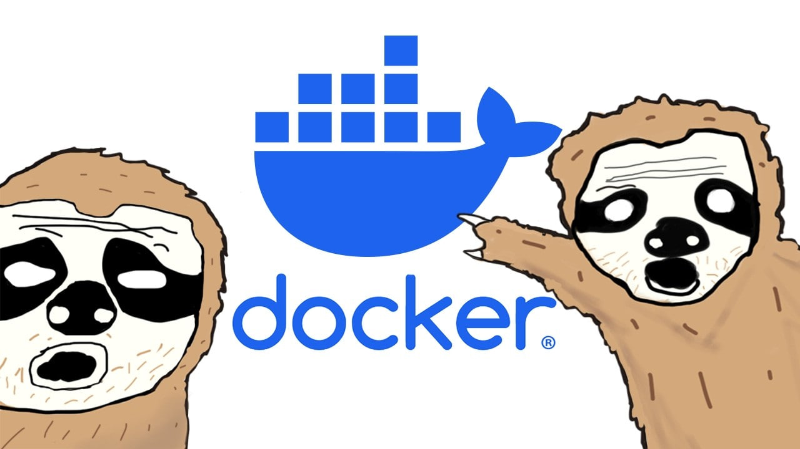

## Часть 0. Сервис

Сервис `api` написан на Go. У него четыре эндпоинта:
- `/health` отвечает `ok`;
- `/eat?mb=N` выделяет N мегабайт памяти и держит их;
- `/burn` грузит одно ядро процессора;
- `/info` показывает pid, uid и hostname процесса (пригодилось для проверок в частях 2 и 5).

Go взял потому, что он собирается в один бинарник без зависимостей. Его легко запустить в пустом namespace и положить в образ `scratch`. Код лежит в `api/main.go`.

## Часть 1. Запуск напрямую

Запустил `api` прямо на VM. `/health` и `/info` отвечают. В `ps` у процесса обычный PID (5590). Я сравнил `/proc/5590/ns` и `/proc/self/ns`: номера namespaces одинаковые, то есть процесс живёт там же, где мой шелл. cgroup тоже общий с сессией.

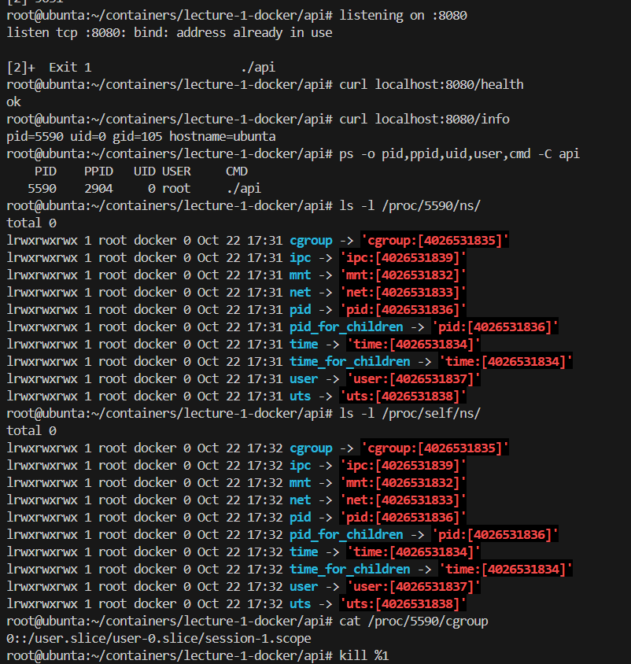

Получается, без изоляции процесс видит все процессы, сеть и имя машины и может забрать сколько угодно памяти и CPU.

## Часть 2. Namespaces

Запустил bash через `unshare --user --map-root-user --pid --fork --mount-proc --uts --ipc --net bash` и проверил, что видно изнутри:
- `echo $$` выдал 1, шелл стал PID 1;
- `ps aux` показывает только bash и сам ps;
- поменял hostname на `box1`, на хосте имя осталось старое;
- в сети только `lo`, и он выключен;
- `ipcs -q` пустой.

После `ip link set lo up` сервис внутри запустился и ответил `pid=15 uid=0 hostname=box1`.

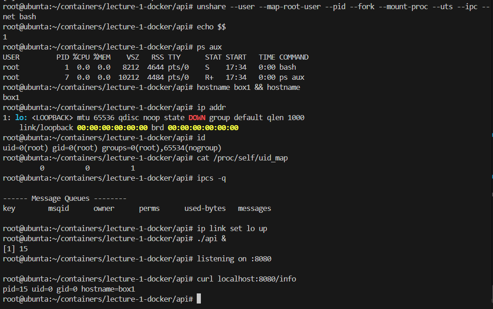

Снаружи тот же процесс виден с обычным PID. В `/proc/<pid>/status` строка `NSpid: 6508 15`: у одного процесса два номера, по одному в каждом PID namespace. `lsns` и сравнение `/proc/<pid>/ns` с `/proc/self/ns` показывают, что у процесса свои user, mnt, uts, ipc, pid и net. С хоста `curl localhost:8080` не проходит, потому что у сервиса своя сеть.

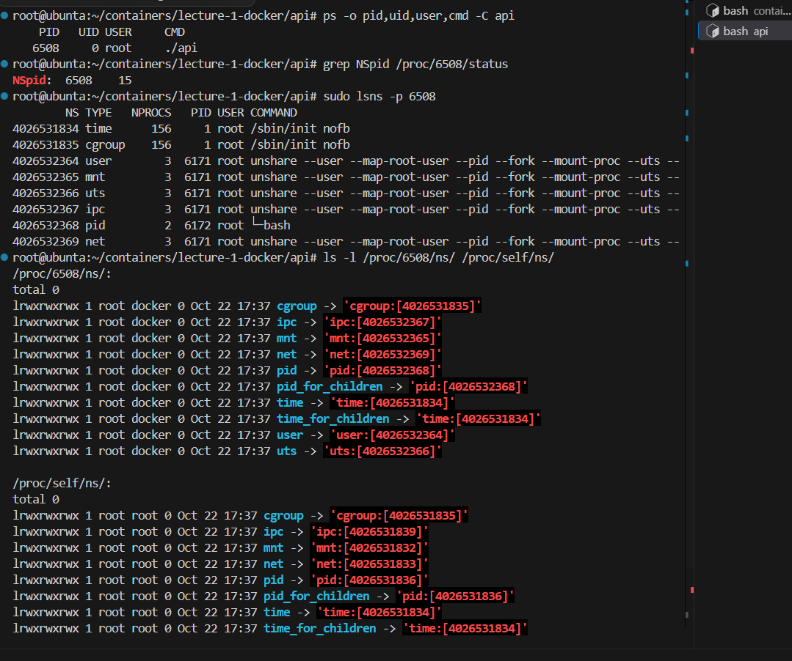

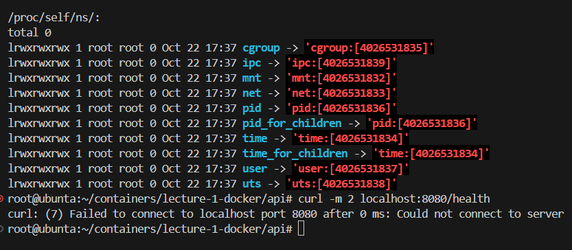

| Namespace | Что отделяет | Что я увидел |
|---|---|---|
| pid | процессы и их номера | шелл стал PID 1, чужих процессов не видно, снаружи это PID 6508 |
| mnt | монтирования | свой `/proc`, поэтому `ps` видит только своё |
| uts | имя хоста | `hostname box1` не поменял имя хоста |
| ipc | очереди и общую память | `ipcs -q` пустой |
| net | сеть | только `lo`, с хоста до 8080 не достучаться |
| user | пользователей и права | у процесса свой user namespace |

Про user namespace есть оговорка. Я запускал `unshare` от root, поэтому `--map-root-user` сопоставил root с root (`uid_map: 0 0 1`), и снаружи процесс тоже виден как uid 0. То, что root внутри может быть обычным пользователем снаружи, я показал в части 5. Там у `mydocker.sh` сопоставление `0 100000 65536`, сервис внутри работает как uid 1000, а на хосте это uid 101000 ([скриншот](images/image9.2.png)).

## Часть 3. cgroups

Создал cgroup `/sys/fs/cgroup/lab1` и задал лимиты:
- память `memory.max=50M`, без swap;
- CPU `cpu.max="50000 100000"`, это половина ядра;
- процессы `pids.max=20`.

Потом перенёс туда процесс `api`.

**Память.** `/eat?mb=20` прошёл, `memory.current` около 22 МБ. На `/eat?mb=40` процесс упёрся в лимит, и ядро его убило: curl получил `Empty reply`, в терминале `Killed`. В `memory.events` появились `oom 1` и `oom_kill 1`, а в `dmesg` запись, что процесс убит из-за памяти в cgroup `/lab1`. В Kubernetes это тот же `OOMKilled`.

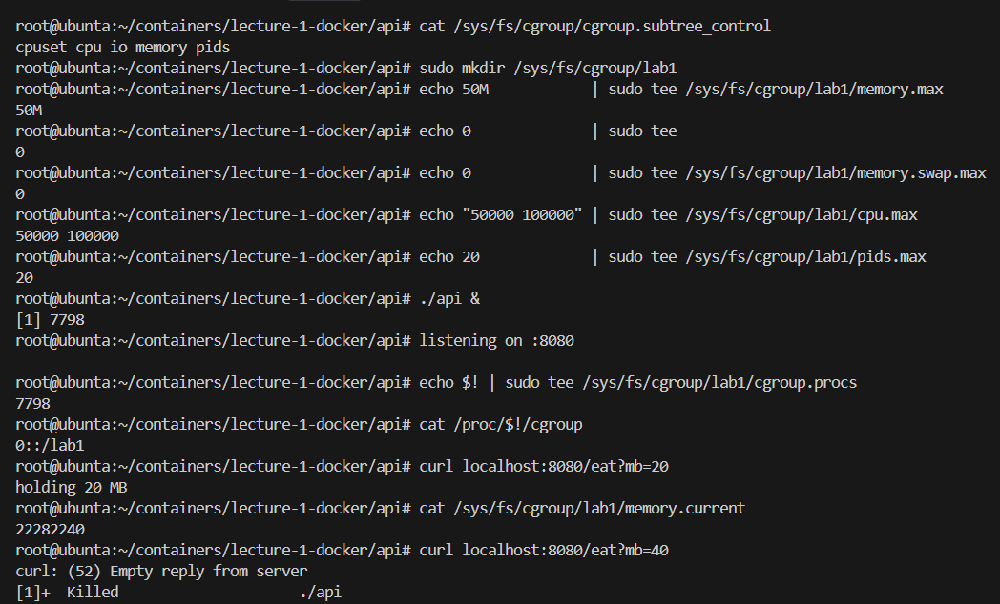

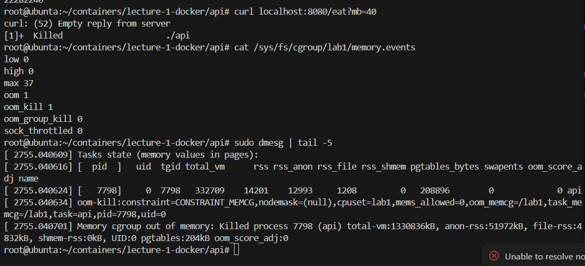

**CPU.** После `/burn` процесс в `top` занимает ровно 50%, а не 100%. В `cpu.stat` растут `nr_throttled` и `throttled_usec`: за время наблюдения `nr_throttled` вырос с 328 до 420 при `nr_periods` 336 → 428. Почти в каждом периоде процесс съедал свою квоту и ждал до конца периода.

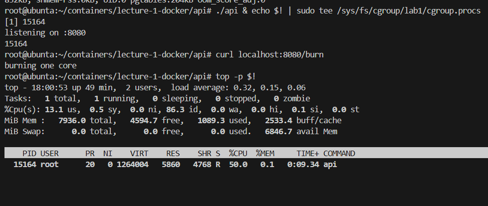

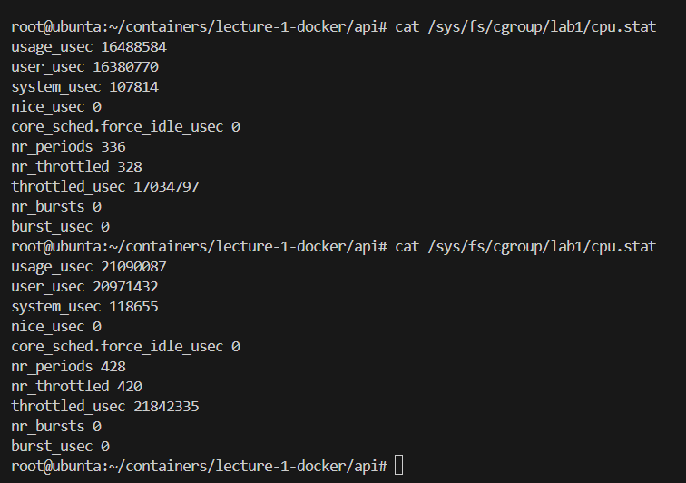

**Процессы.** Запустил внутри группы `stress-ng --fork 20`. Процессов больше 20 не стало (`pids.current = 20`), а счётчик отказов `pids.events max` рос от 5707 до 28435. Машина при этом работала нормально.

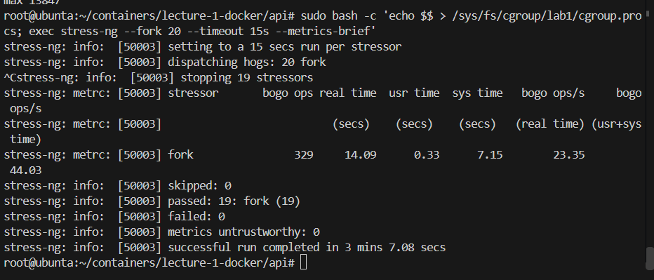

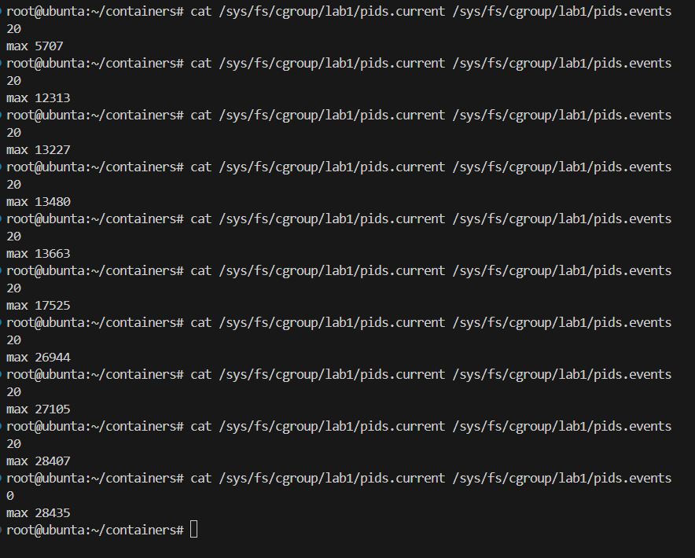

## Часть 4. Права

**Capabilities.** У root все capabilities (`CapEff: 000001ffffffffff`). Обычный `sudo date -s` работает, а с `capsh --drop=cap_sys_time` выдаёт `cannot set date: Permission denied`. Так же без `CAP_NET_BIND_SERVICE` сервис не смог занять порт 80.

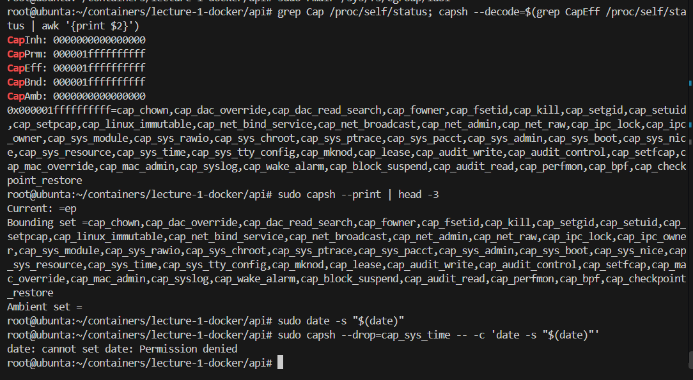

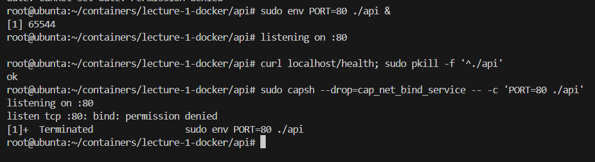

**Seccomp.** Стандартной утилиты, чтобы повесить seccomp на процесс, нет. Поэтому я написал маленькую программу на C с libseccomp (`seccomp-exec.c`) и два профиля:
- с демо-профилем не работает `mkdir`;
- с рабочим профилем не работает `unshare`;
- в `/proc/self/status` видно `Seccomp: 2`, то есть фильтр включён.

Тот же запрет `mkdir` проверил в Docker через JSON-профиль, он тоже сработал.

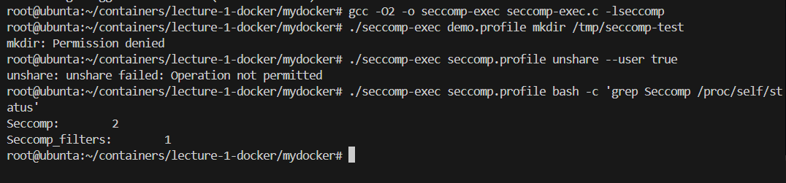

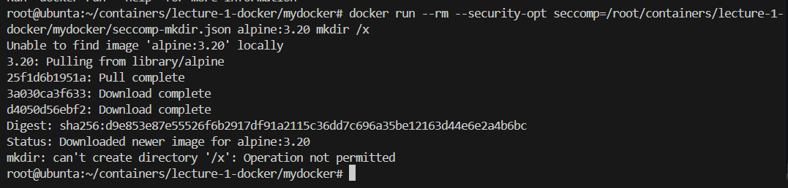

Что даёт каждая защита:
- capabilities делят права root на части, и процессу можно оставить только нужные;
- seccomp запрещает отдельные системные вызовы, поэтому даже взломанный сервис не сможет вызвать что-то опасное в ядре;
- no_new_privs не даёт поднять права через setuid-программы.

## Часть 5. Свой Docker

Собрал скрипт `mydocker.sh`. Что он делает по шагам:
1. создаёт cgroup с лимитами;
2. запускает процесс в новых user, pid, mnt, uts, ipc, net и cgroup namespaces, root внутри становится uid 100000 снаружи;
3. делает veth-пару между хостом и контейнером;
4. внутри меняет пользователя на обычного, убирает все capabilities, включает no_new_privs и seccomp и запускает сервис.

Проверил сопоставление пользователей: внутри `uid=0(root)`, `uid_map 0 100000 65536`.

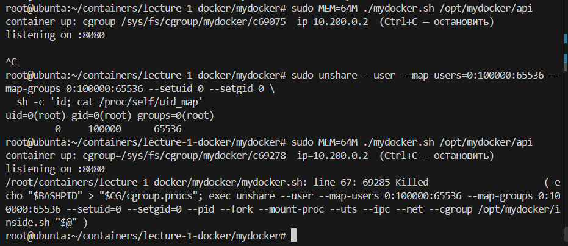

Что получилось:
- `curl 10.200.0.2:8080/info` отвечает `pid=1 uid=1000 hostname=mydocker`;
- на хосте процесс работает под uid 101000, у него 7 своих namespaces;
- в `/proc/<pid>/status` `CapEff: 0`, `CapBnd: 0`, `NoNewPrivs: 1`, `Seccomp: 2`;
- cgroup процесса `/mydocker/c69278`;
- `/eat?mb=100` при лимите 64M оборвал соединение, сработал OOM.

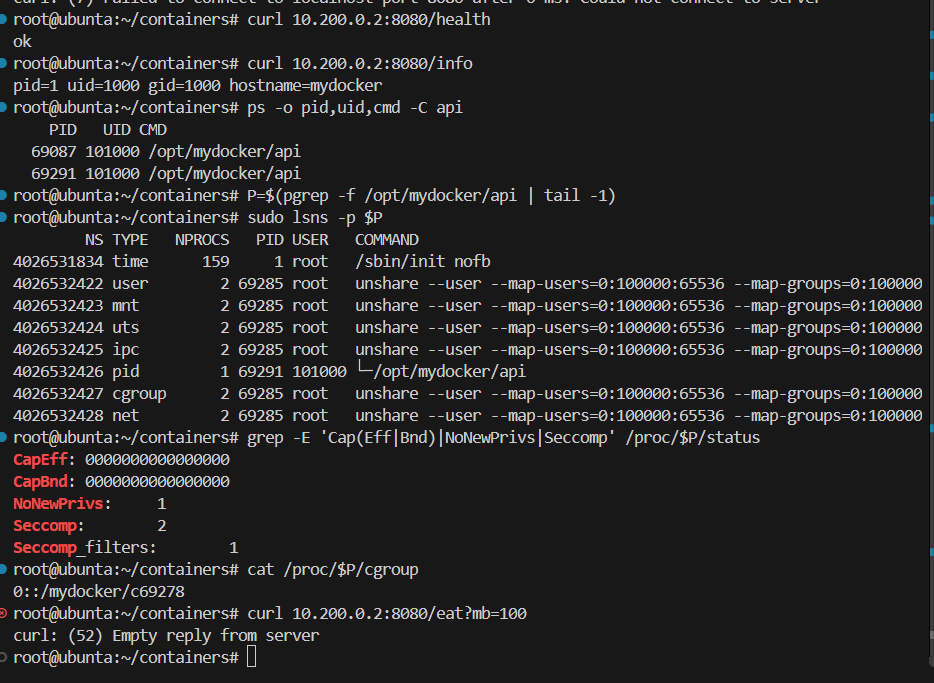

Тот же сервис запустил через `docker run --memory 64m --cpus 0.5 --pids-limit 64`:
- свои mnt, uts, ipc, pid, cgroup и net namespaces есть, а user namespace общий с хостом;
- процесс работает от `nobody` (uid 65534, так задано в Dockerfile), поэтому `CapEff: 0`, но набор `CapBnd: a80425fb` у Docker урезанный, а не пустой;
- `NoNewPrivs: 0`, `Seccomp: 2`;
- лимит памяти 64 МБ стоит в cgroup контейнера.

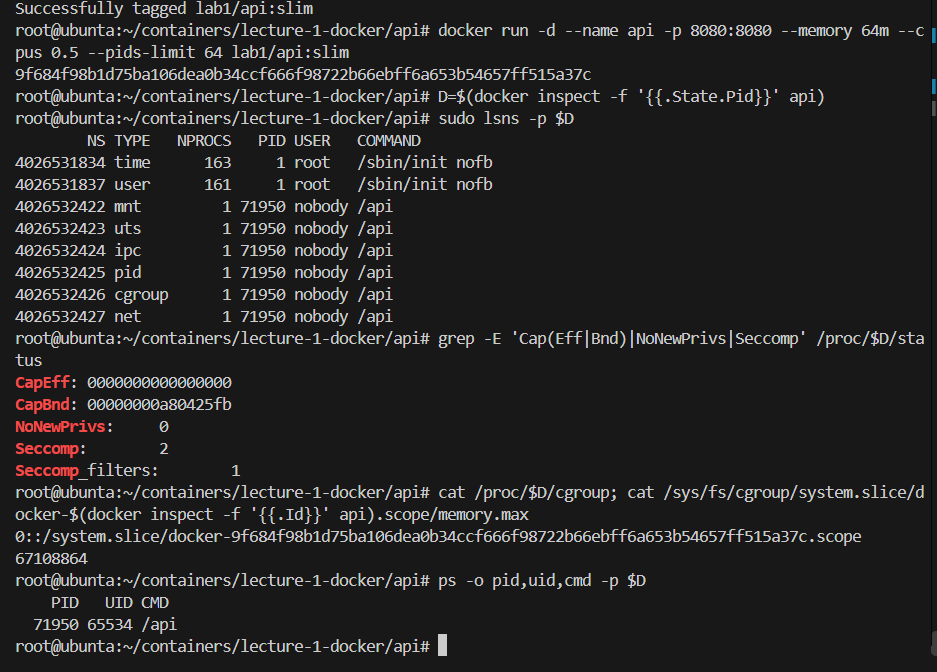

| | mydocker.sh | docker run |
|---|---|---|
| namespaces pid, mnt, uts, ipc, net, cgroup | есть | есть |
| user namespace | есть, root внутри это uid 100000 снаружи | нет, общий с хостом |
| лимиты памяти, CPU, процессов | есть | есть |
| capabilities | убраны все | урезанный набор |
| no_new_privs | включён | по умолчанию выключен |
| seccomp | свой список запретов | встроенный профиль |
| файловая система | общая с хостом | своя, из образа |
| сеть | veth без NAT | bridge, NAT и проброс портов |
| что есть только у Docker | | образы, тома, AppArmor, логи, перезапуск, healthcheck |

Вывод: контейнер это обычный процесс, на который навешены namespaces, cgroups и ограничения прав. Docker делает то же самое, но ещё даёт файловую систему из образа, сеть и управление жизнью контейнера. По пользователям мой скрипт даже строже: в Docker без `userns-remap` root в контейнере это root на хосте.

## Часть 6. Образы

Сделал два Dockerfile: обычный на базе `golang:1.22` (`Dockerfile.fat`) и multi-stage, где в итоговый образ `scratch` копируется только бинарник.

| Образ | На диске | Сжатый | Слоёв |
|---|---|---|---|
| fat (golang) | 1.31 ГБ | 319 МБ | 11 |
| slim (scratch) | 6.88 МБ | 2.09 МБ | 1 |

По `docker history` видно, откуда разница: в `fat` весь Go с компилятором (только сборка заняла 77 МБ), а в `slim` один слой с бинарником на 4.78 МБ.

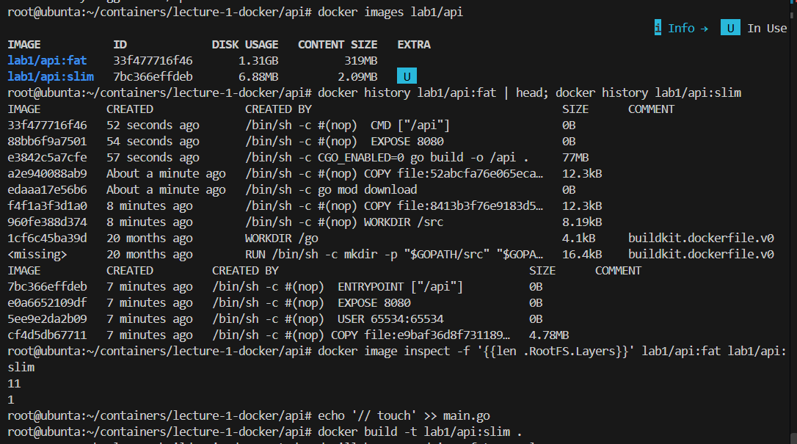

Потом поменял только `main.go` и пересобрал. Шаги до копирования кода взялись из кэша (`Using cache`), пересобрались только `COPY *.go` и компиляция. Поэтому зависимости копируются раньше кода: если код меняется, их не нужно скачивать заново.

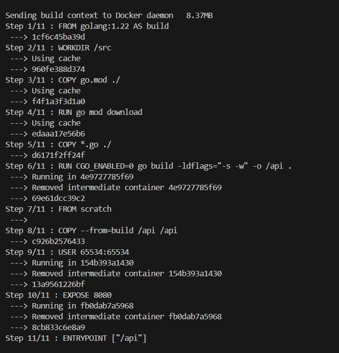

Проверил, где хранятся данные. Записал файл внутри контейнера и пересоздал контейнер, файл пропал. Запись идёт в верхний слой контейнера, а он удаляется вместе с контейнером. С томом `notes` файл остался, потому что том это папка на хосте, она живёт отдельно. Команда `docker inspect -f '{{.GraphDriver.Data.UpperDir}}'` выдала ошибку: в Docker 29 образы хранятся через containerd, и поля `GraphDriver` больше нет.

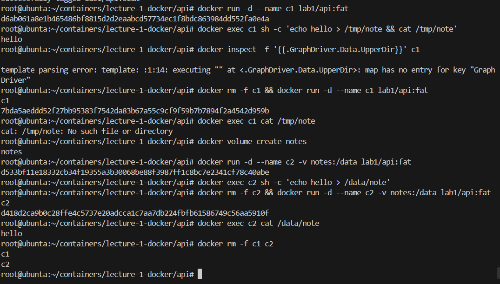

## Часть 7. gVisor

Поставил `runsc` и подключил его к Docker. В `docker info` появился runtime `runsc`.

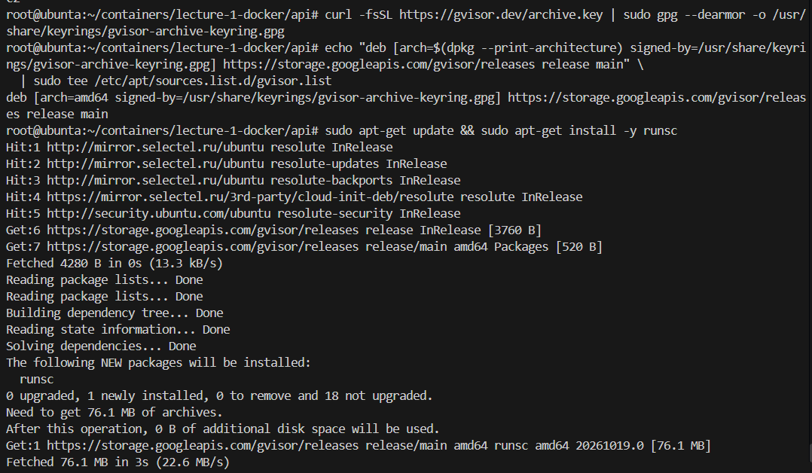

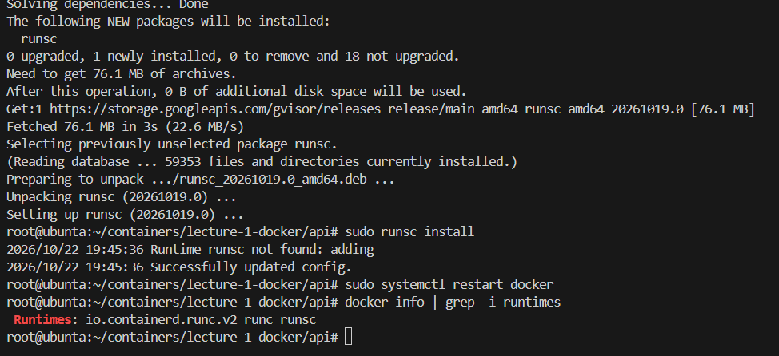

Сравнил с обычным запуском:
- обычный контейнер показывает в `uname -r` ядро VM `7.0.0-38-generic`, а под runsc показывает `4.19.0-gvisor`;
- `dmesg` под runsc выводит сообщения самого gVisor, а не ядра хоста;
- образ `lab1/api:slim` под gVisor работает, `/health` отвечает;
- на хосте вместо процесса сервиса видны процессы `runsc-sandbox`, `runsc-gofer` и `runsc-fd-parking`.

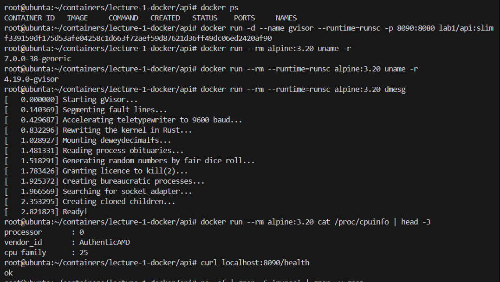

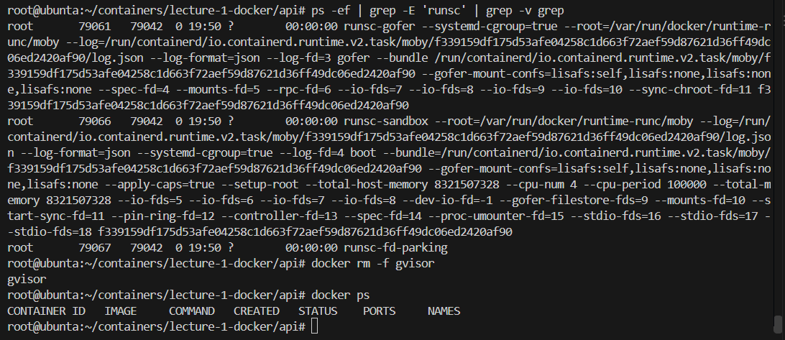

Что я понял:
- gVisor это своё ядро, которое работает как обычная программа. Оно перехватывает системные вызовы приложения и выполняет их само, а к настоящему ядру обращается редко и через короткий список вызовов. За файлы отвечает отдельный процесс gofer. Получается ещё одна стенка между приложением и ядром;
- мой скрипт и обычный Docker прячут процессы и сеть, ограничивают ресурсы и права, но системные вызовы всё равно выполняет общее ядро хоста;
- у обычного контейнера с хостом всегда общее ядро. Если в ядре найдут уязвимость, ей можно воспользоваться из любого контейнера. Ещё общими остаются время и модули ядра. Поэтому для чужого, непроверенного кода берут gVisor, microVM или обычную виртуалку.

## Часть 8. Мониторинг

Поднял cAdvisor, Prometheus и Grafana через docker compose.

Сначала метрик контейнеров не было. cAdvisor не смог разобраться в контейнерах Docker 29: он ищет слои в старой папке `layerdb`, не находит их и пропускает такие контейнеры. В логе ошибка `failed to identify the read-write layer ID`.

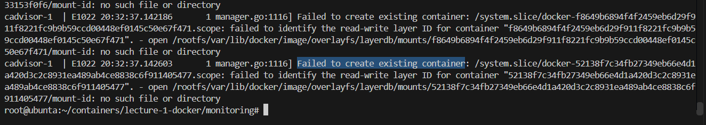

Я выключил у cAdvisor работу с Docker, и он стал брать метрики прямо из cgroup `/system.slice/docker-<id>.scope`. Короткий ID контейнера вытащил в метку `container_id` через `metric_relabel_configs` в Prometheus. Заодно стало видно, что метрики контейнера это просто метрики его cgroup, и Docker для них не обязателен.

Дашборд по контейнеру api:
- доля throttled-периодов после `/burn` держится на 100%, потому что лимит 0.5 CPU кончается в каждом периоде;
- память при серии `/eat` дошла до лимита 128 MiB;
- ещё есть панели CPU и OOM-событий.

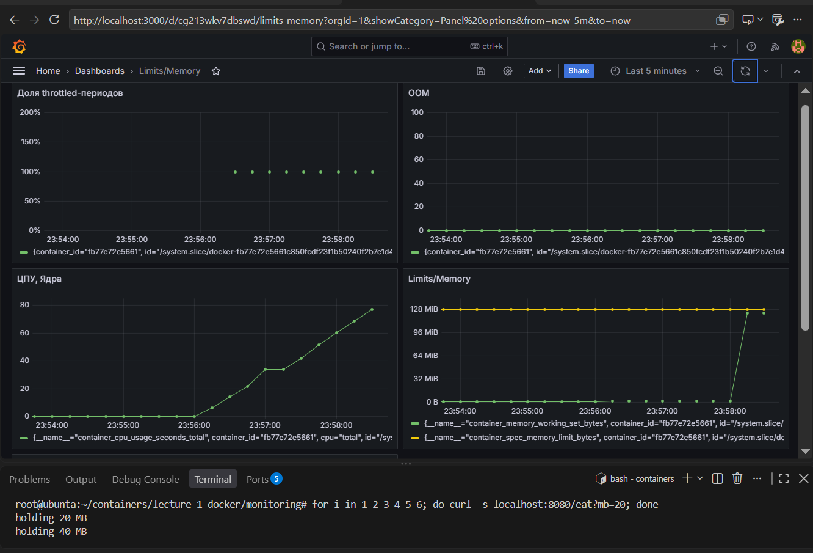

Три метрики, на которые я бы повесил алерты:
1. Память больше 90% от лимита. Это заранее говорит, что скоро будет OOM. OOM убивает процесс сразу и обрывает запросы, поэтому лучше узнать раньше.
2. Доля throttled-периодов больше 25%. Лимит CPU не убивает процесс, а замедляет. Средняя загрузка при этом выглядит нормально, а ответы становятся медленнее.
3. Любое OOM-событие. Это уже падение процесса. Если повторяется, значит утечка памяти или лимит слишком маленький.

## Коротко о моём докере

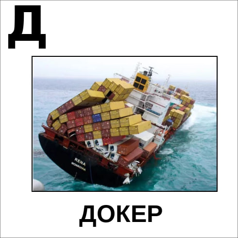