# Лаба 2. Мониторинг сервиса

## Часть 0. Сервис

Сервис `api` написан на Python (Flask и gunicorn). Эндпоинты: `/health`, `/fail`, `/slow`, `/load`. Сервис:
- отдаёт метрики RED на `/metrics`;
- пишет логи в JSON, и в каждой строке есть `trace_id`;
- подключён к OpenTelemetry.

Собрал образ и загрузил его в minikube через `minikube image load`.

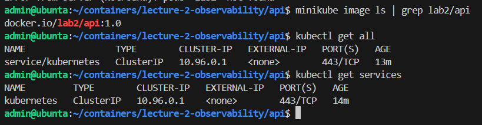

Весь стек ставил через Helm в namespace `monitoring`: kube-prometheus-stack (в нём Prometheus, Grafana и Alertmanager), Loki, Alloy, Jaeger и Karma. Сервис поставил своим Helm-чартом в namespace `demo`, вместе с ServiceMonitor и приёмником алертов `alert-echo`.

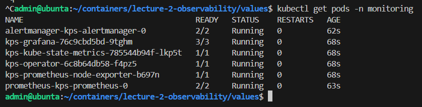

При первом запуске под сервиса падал. Библиотеке OpenTelemetry нужен `pkg_resources`, а в образе `python:3.12-slim` нет `setuptools`. Добавил `setuptools<81` в `requirements.txt`, пересобрал образ как `lab2/api:1.1` и обновил релиз. После этого под заработал.

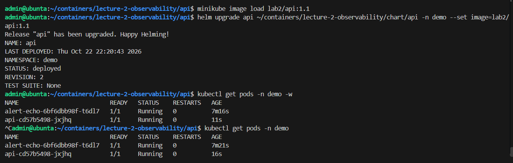

## Часть 1. Метрики

Сервис подключил к Prometheus через ServiceMonitor. Prometheus Operator находит по меткам нужный Service и сам дописывает настройку сбора. Цель `serviceMonitor/demo/api/0` в состоянии UP, метки `job`, `namespace`, `pod` подставились сами.

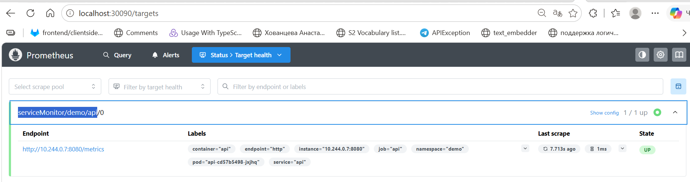

В Grafana собрал дашборд RED из трёх панелей:
- RPS по эндпоинтам;
- доля ответов 5xx. В запрос добавил `or vector(0)`, иначе без ошибок Grafana пишет «No data» вместо нуля;
- p95 времени ответа по эндпоинтам.

Первая версия дашборда, где виден только фоновый трафик `/health` от проверок Kubernetes:

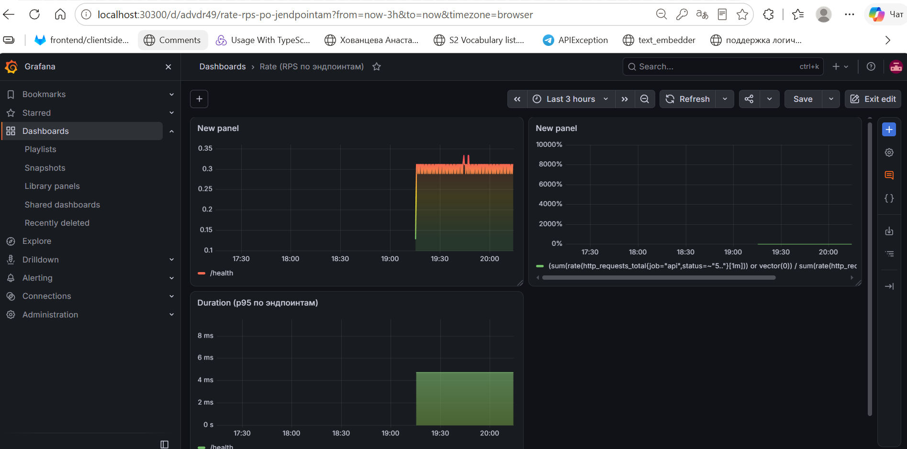

Потом давал нагрузку по очереди, по минуте на каждый вид:
1. `/load`: RPS поднялся примерно до 150, потому что `/load` сам дёргает `/health`;
2. `/fail` вперемешку с `/health`: доля ошибок поднялась почти до 50%;
3. `/slow`: p95 у `/slow` вырос примерно до 2.9 секунды.

Каждый график отреагировал на свою нагрузку.

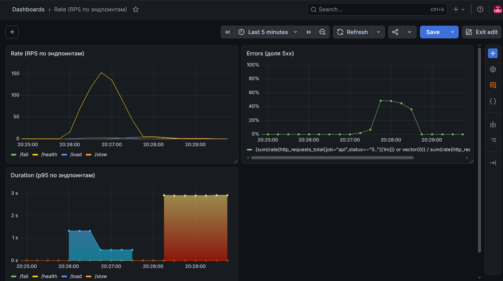

## Часть 2. Логи

Поднял Loki и Alloy. Loki только хранит логи, сам он их ниоткуда не забирает. Собирает их Alloy: он запущен на каждой ноде (DaemonSet), читает вывод подов своей ноды, добавляет метки namespace, pod, app, level и отправляет в Loki. Loki подключил к той же Grafana.

После вызовов `/fail` нашёл ошибки запросом `{namespace="demo", app="api"} | json | level="ERROR"`. В строке лога есть `path: /fail`, `status: 500` и `trace_id`.

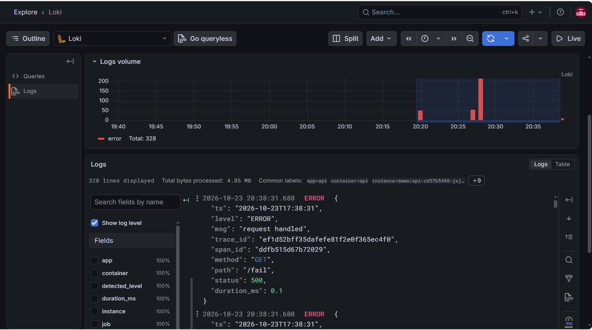

`trace_id` я не стал делать меткой Loki. Метки индексируются, а у каждого запроса свой trace_id, и индекс разросся бы до огромных размеров.

## Часть 3. Трейсы

Поднял Jaeger в варианте all-in-one и настроил отправку трейсов из сервиса. Jaeger подключил к Grafana, поэтому трейсы смотрел там же, в Explore.

**`/slow`.** На каждый запрос OpenTelemetry сам создаёт основной спан. Медленную часть я обернул в отдельный спан `slow-op`. В трейсе `GET /slow` (2.1 с) видно, что почти всё время, 2.09 с, ушло именно на `slow-op`.

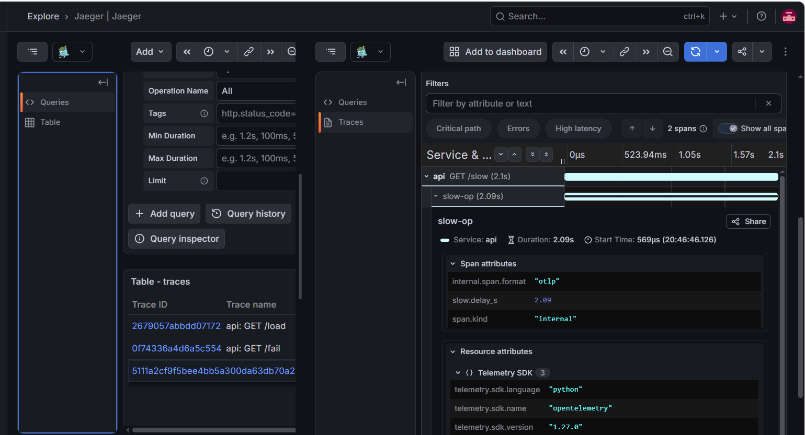

**`/fail`.** Спан помечен как ошибка: он красный и у него `http.status_code: 500`.

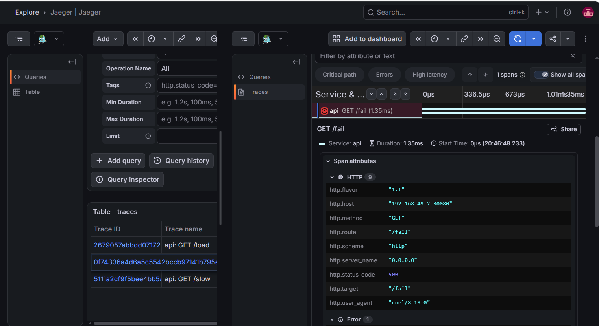

**Связь лога и трейса.** 
Также взял `trace_id` из строки лога в Grafana (`ef1d52bff35dafefe81f2e0f365ec4f0`) и нашёл по нему тот же трейс в Jaeger.

## Часть 4. Алерты

Написал правила алертов на PromQL и подключил Alertmanager. Алерты приходят на webhook, это маленький echo-сервис в кластере, который печатает их в свой лог. Поверх Alertmanager поставил Karma.

| Алерт | Когда срабатывает | Почему это важно | Что делать дежурному |
|---|---|---|---|
| ApiHighErrorRate | больше 5% ответов 5xx в течение 2 минут | пользователи прямо сейчас получают ошибки | посмотреть логи ERROR, по trace_id найти трейс и понять, на каком шаге падает; если виноват релиз, откатить |
| ApiHighLatencyP95 | p95 больше 1 секунды в течение 3 минут | каждый двадцатый запрос ждёт дольше секунды | найти в Jaeger самые долгие трейсы и самый длинный спан, проверить, хватает ли ресурсов |
| ApiDown | нет ни одной живой цели для сбора метрик | сервис не работает совсем | `kubectl get pods,endpoints`, посмотреть события и последний деплой |

**ApiHighErrorRate.** Дал цикл запросов `/fail`. Правило сработало, доля ошибок 93.9%. Алерт пришёл в Alertmanager на webhook и показался в Karma.

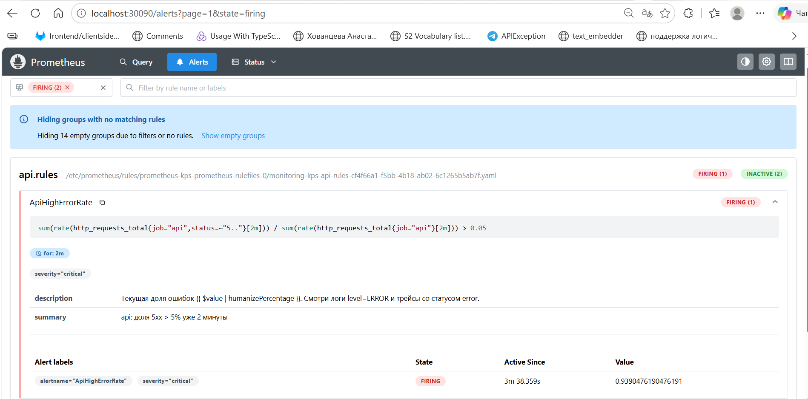

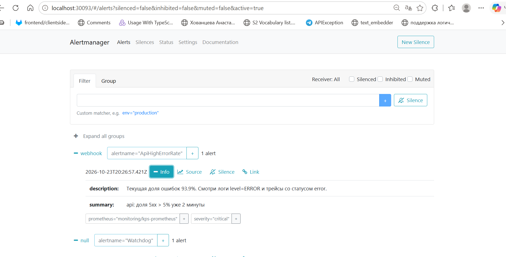

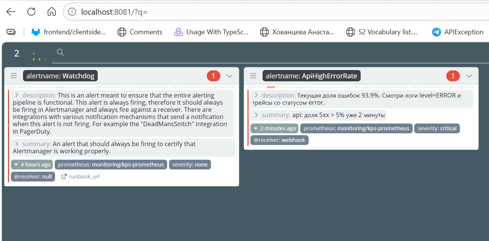

**ApiHighLatencyP95.** Гонял параллельные запросы `/slow`. p95 получился 2.87 с, правило сработало.

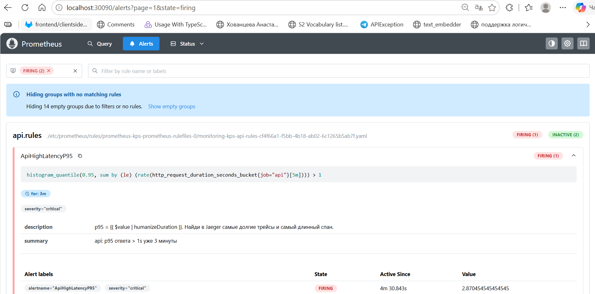

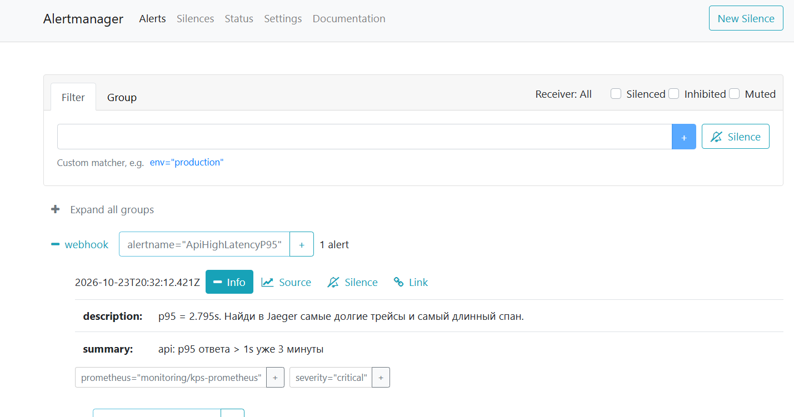

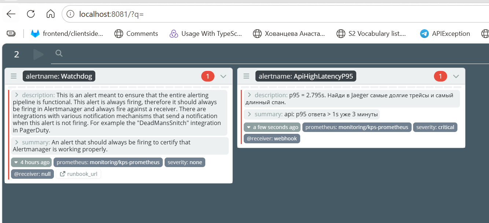

**ApiDown.** Убрал все реплики командой `kubectl scale --replicas=0`. Через минуту сработало правило `absent(up{job="api"} == 1)`.

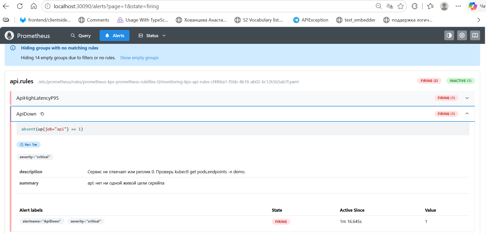

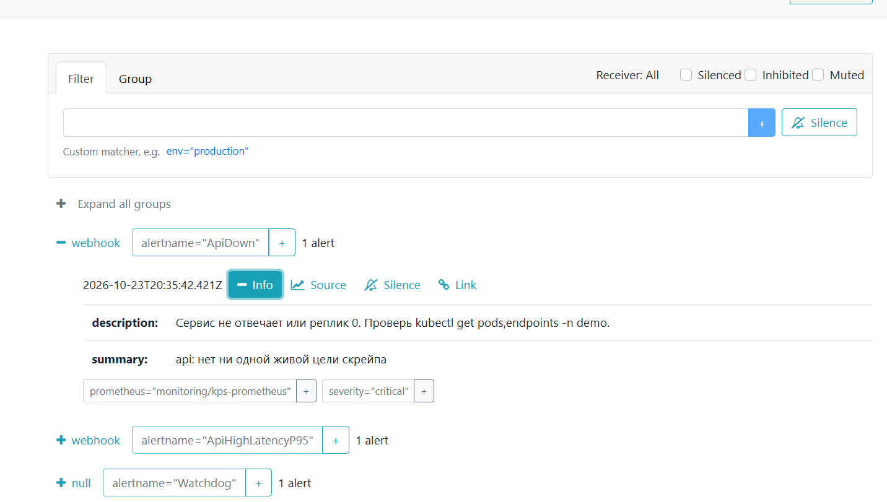

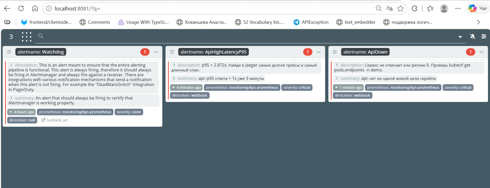

`Watchdog` это служебный алерт из kube-prometheus-stack. Он горит всегда и показывает, что вся цепочка алертов работает. В Alertmanager он отправлен в пустой получатель `null`.

## Итог

Получился один стек, поставленный через Helm:
- метрики: Prometheus и Grafana;
- логи: Alloy, Loki и Grafana;
- трейсы: OpenTelemetry и Jaeger, смотрю в Grafana;
- алерты: Prometheus, Alertmanager, webhook и Karma.

Настройки лежат в `values/*.yaml` и в чарте сервиса `chart/api`.
