# Лаба 3. Платформа для shop

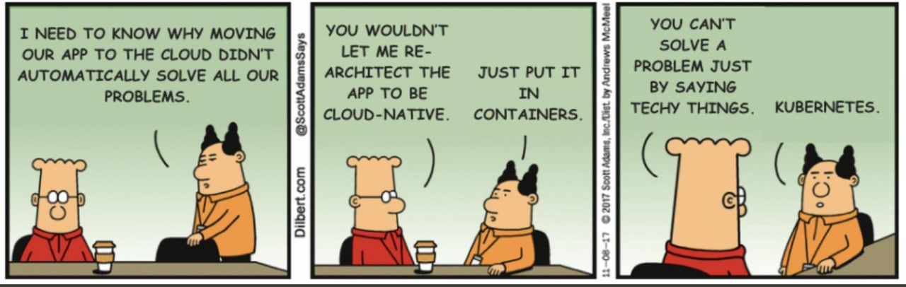

Код и чарт лежат в `~/containers/shop/`. Это общий проект для лаб 3–6: там `src/`, `policies/` и `chart/shop/`.

## Часть 0. Сервисы

Сделал два сервиса:
- `api`: `/health` (если выставить `HEALTH_FAIL=true`, отвечает ошибкой), `POST /order`, `GET /orders`, `/metrics`;
- `worker`: берёт новые заказы из Postgres, помечает их обработанными и отдаёт метрики.

Образы назвал `shop.local/<имя>:<версия>` и загрузил в minikube.

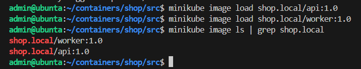

## Часть 1. Ограждения

Выбрал Kyverno. Его правила пишутся обычным YAML, как остальные манифесты Kubernetes, отдельный язык (Rego у Gatekeeper) учить не нужно. Ещё Kyverno сам применяет правило для Pod к Deployment и другим контроллерам, поэтому Helm получает отказ сразу при создании Deployment. Gatekeeper умеет больше, но мне это здесь не нужно.

Завёл 5 правил на весь кластер, все в режиме Enforce:

| Правило | Зачем |
|---|---|
| обязательные requests и limits | без requests планировщик не знает, сколько места нужно поду, а limits защищают соседей по ноде |
| образы только из `shop.local` и CNPG | чтобы не запустить чужой или подменённый образ |
| обязательные метки `app.kubernetes.io/name` и `part-of` | по меткам работают Service, NetworkPolicy и мониторинг |
| запрет privileged | privileged-контейнер по сути root на ноде |
| запрет тега `latest` | с `latest` нельзя точно повторить деплой и откатиться |

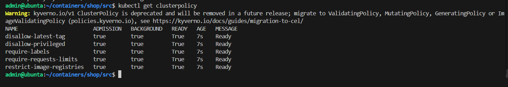

Подготовил 5 манифестов, каждый нарушает одно правило. Kyverno отклонил все пять и для каждого написал, какое правило нарушено и в каком месте манифеста. Пятый манифест это Deployment, его отклонило правило `autogen-require-explicit-tag`, которое Kyverno создал сам из правила для Pod.

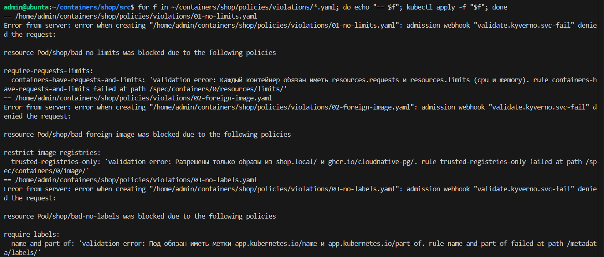

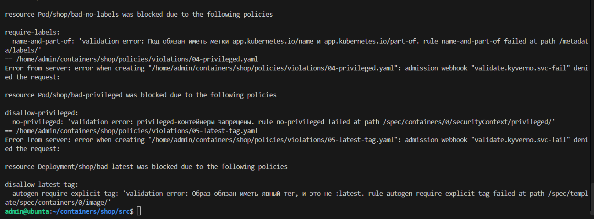

## Часть 2. Чарт api и worker

Написал Helm-чарт `shop`:
- `api` по умолчанию 3 реплики, `worker` 2;
- у обоих readiness и liveness пробы на `/health`;
- requests и limits, нужные метки;
- для api обновление по одному поду (`maxSurge: 1`, `maxUnavailable: 0`) и `preStop`.

Сначала закомментировал `resources` у worker и попробовал поставить чарт. Установка упала с двумя ошибками:
- Kyverno не пустил Deployment worker без limits;
- порт NodePort 30080 уже был занят сервисом из лабы 2. NodePort должен быть уникальным на весь кластер, а не на namespace.

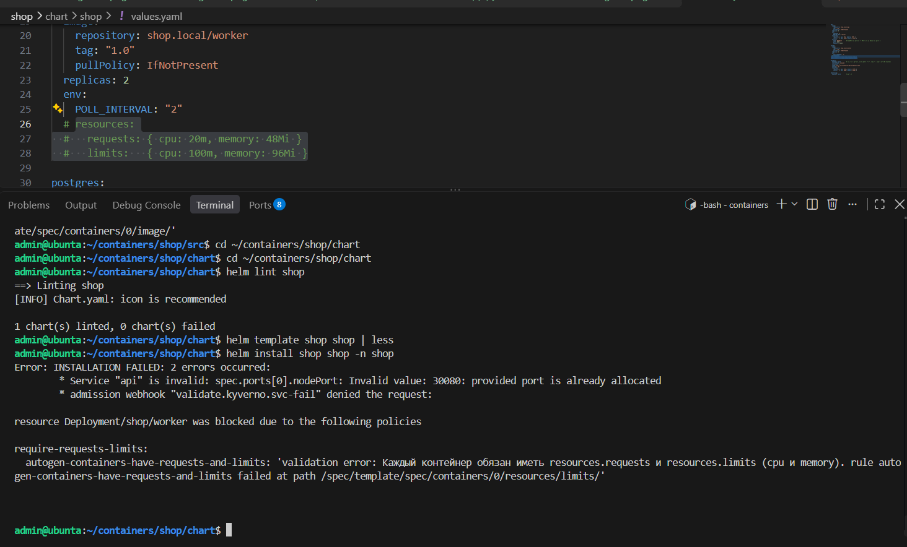

Вернул `resources`, а сервис лабы 2 перевёл на порт 30082. После этого чарт поставился без ошибок, и `/health` через NodePort отвечает `ok`.

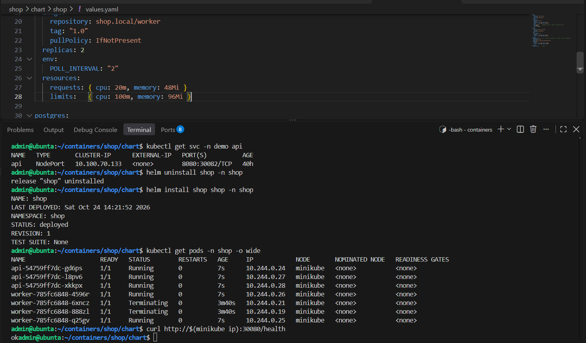

**Reconciliation.** Удалил один под api, и ReplicaSet сразу создал новый с другим именем (`8ktv9`: ему 13 секунд, двум старым 71).

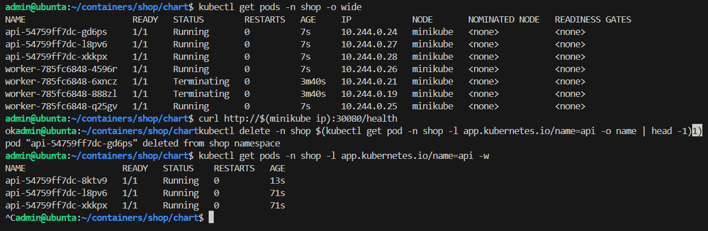

Потом поменял в `values.yaml` `api.replicas` с 3 на 4 и сделал `helm upgrade` (ревизия 19). Deployment довёл число подов до 4, появился один новый под. То есть я меняю описание в чарте, а Kubernetes сам приводит кластер к нему.

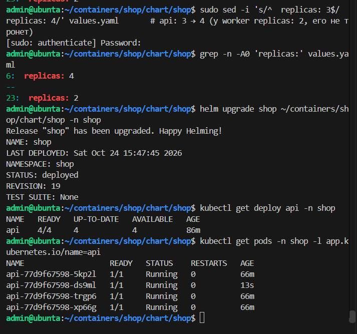

**Rolling update.** Вернул `replicas: 3`, поменял тег образа api с `"1.0"` на `"1.1"` и сделал `helm upgrade` (ревизия 21). В соседнем терминале всё это время крутился цикл запросов к `/health` через NodePort. Новые поды появлялись по одному, с разницей в пару секунд (им 7, 5 и 3 секунды), а старые уходили в `Terminating` только после этого. Клиент не получил ни одной ошибки: `ok=1569 fail=0`.

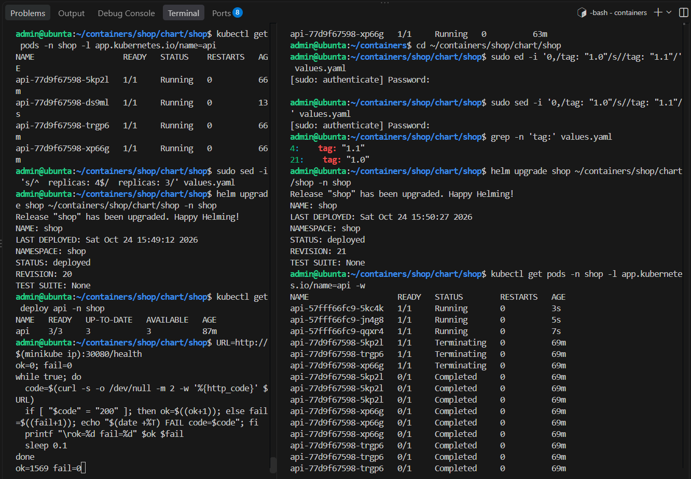

После обновления `rollout status` написал `successfully rolled out`, и Deployment работает на образе `shop.local/api:1.1`. По списку ReplicaSet видно, как это устроено:
- Deployment не меняет поды на месте, а создаёт новый ReplicaSet (`57fff66fc9`, 3/3) и переносит реплики на него по одной;
- старые ReplicaSet остаются с нулём подов, среди них и `794fdc965d` от сломанного релиза с `HEALTH_FAIL`. Они нужны для отката.

Клиент к концу: `ok=1905 fail=0`.

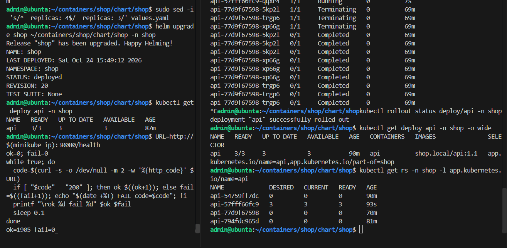

Почему обошлось без ошибок: новый под создаётся раньше, чем удаляется старый; трафик идёт только на поды, которые прошли readiness; `preStop` даёт несколько секунд, чтобы под успели убрать из балансировки до остановки.

**Сломанный релиз.** Выставил `HEALTH_FAIL: "true"` и сделал `helm upgrade` (ревизия 4). Новый под `api-794fdc965d-mkdzt` так и остался `0/1`, а `rollout status` завис на `1 out of 3 new replicas`. Клиент продолжал получать 200 (`ok=2210 fail=0`). Из-за `maxUnavailable: 0` ни один старый рабочий под не удалили.

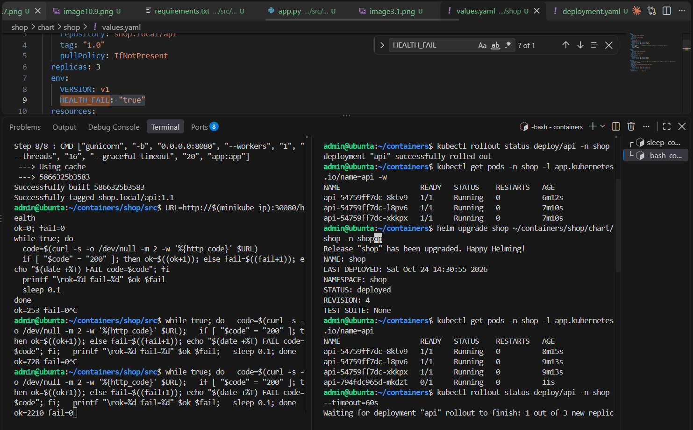

В событиях нового пода видно почему: readiness и liveness получают 503, и kubelet перезапускает контейнер по liveness. Клиент к этому моменту `ok=2609 fail=0`.

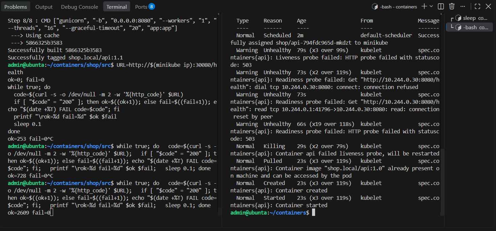

Сделал `helm rollback shop 3`. Обновление завершилось, остались три старых рабочих пода.

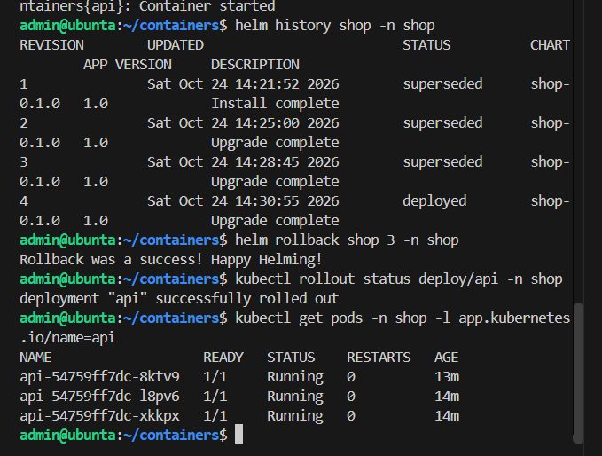

## Часть 3. Postgres через оператор

Поставил оператор CloudNativePG и добавил в чарт объект `Cluster`. Оператор сам создал под Postgres, том и Secret `shop-db-app` с параметрами подключения. `api` и `worker` берут `DATABASE_URL` из этого Secret. Заказы создаются и обрабатываются (`processed: true`).

Удалил под `shop-db-1`, и оператор вернул его с тем же именем: `Terminating` -> `Completed` -> `Pending` -> `Init` -> `Running`. Пока Postgres перезапускался, `/orders` отвечал `db unavailable`. Когда под вернулся, все три старых заказа были на месте. Значит, оператор подключил тот же том.

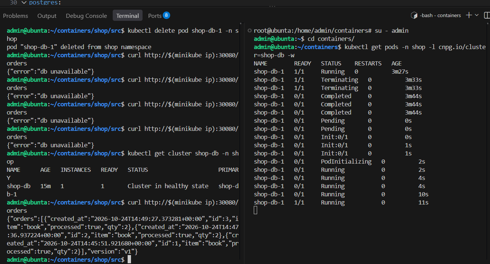

Сначала под долго висел в `Terminating`. При остановке CNPG ждёт, пока клиенты сами закроют соединения с базой, по умолчанию до 3 минут. Я добавил в шаблон `Cluster` `smartShutdownTimeout: 10` и `stopDelay: 60`. После `helm upgrade` оператор сам перезапустил Postgres, чтобы применить новые настройки. Это тот же цикл сверки, только сработал он от изменения `spec`, а не от удаления пода.

Объект `Cluster`:
- `spec` это то, что я хочу, оно пришло из чарта: `instances: 1`, `imageName`, `bootstrap.initdb`, `inheritedMetadata`. Там есть и поля, которых в чарте нет (`enablePDB`, `affinity`, `failoverDelay`). Их при создании дописал webhook оператора, это значения по умолчанию;
- `status` это то, что есть на самом деле, его заполняет оператор: `phase: Cluster in healthy state`, `currentPrimary: shop-db-1`, `readyInstances: 1`.

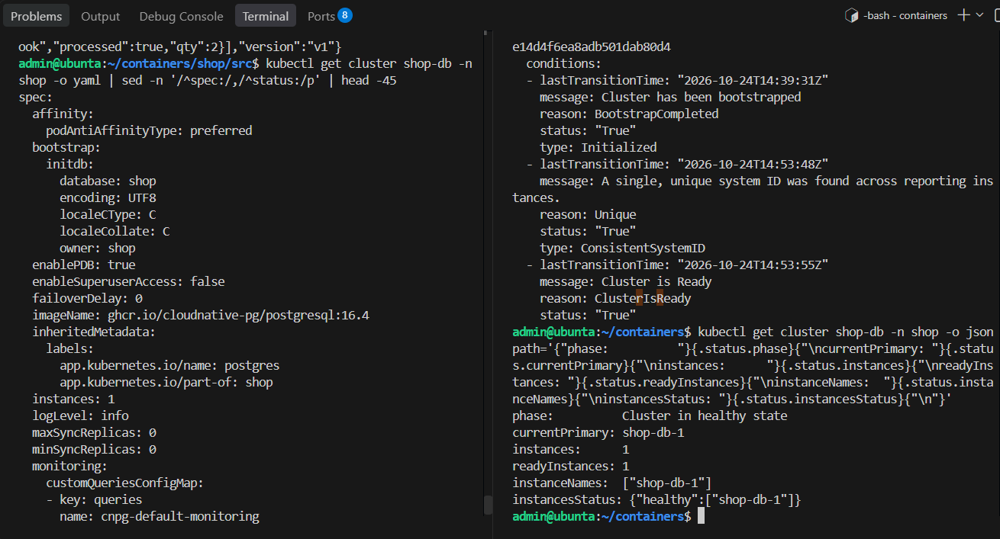

Чем оператор отличается от `controller-manager`. Принцип у них один: следить за объектом и подтягивать `status` к `spec`. Разница в том, что они знают:
- `controller-manager` знает только встроенные типы и общую логику вроде «нужно N одинаковых подов»;
- оператор работает со своим типом (`Cluster`) и знает, как обслуживать конкретную базу: создать её, завести пользователей и секреты, следить за primary и репликами, переключаться при сбое, возвращать под с тем же именем и томом.

## Часть 4. Падение control plane

Остановил `kube-apiserver`: через `minikube ssh` убрал его манифест из `/etc/kubernetes/manifests`. После этого `kubectl get pods` получал `connection refused`, а `helm upgrade` писал `Kubernetes cluster unreachable`. Клиент в соседнем терминале всё это время получал `health=ok orders=200`.

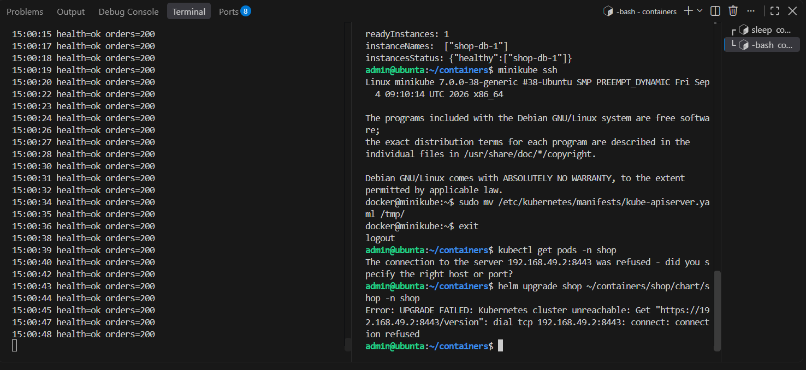

Всё, что уже было запущено, продолжило работать. Трафик идёт по правилам kube-proxy, которые уже записаны на ноде, а за подами следят kubelet и container runtime. Перестало работать только управление: нельзя ничего поменять, и никто не восстановит упавший под.

Вернул манифест на место. Через несколько секунд `kubectl get nodes` снова заработал, но первые два `helm upgrade` всё равно падали с `failed calling webhook "mcluster.cnpg.io" ... connection refused`.

Причина: изменения объекта `Cluster` проверяет webhook оператора CloudNativePG. Пока API-сервер не работал, оператор не мог продлить свою блокировку лидера (она тоже хранится через API) и перезапустился. Пока он поднимался, API-сервер не мог проверить объект и отклонял изменения. Примерно через минуту оператор поднялся, и `helm upgrade` прошёл (ревизия 10). Клиент всё это время получал `health=ok orders=200`.

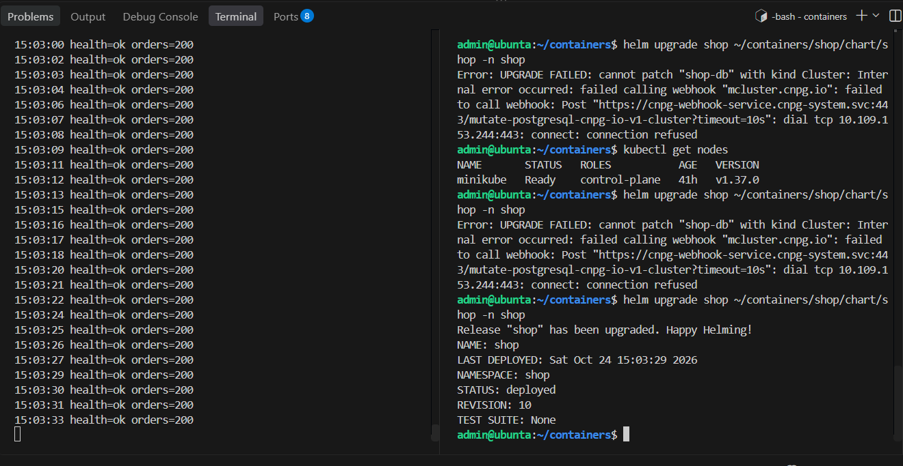

Вывод: кластер снова управляем не в момент, когда поднялся API-сервер, а когда поднялось всё, через что проходят запросы, включая webhook-и операторов и Kyverno. На работу самого приложения это не влияет: его трафик через control plane не идёт.

## Часть 5. Мониторинг

Добавил в чарт мониторинг и использовал стек из лабы 2:
- ServiceMonitor для `api` и `worker`;
- PodMonitor для Postgres (метрики CNPG на порту 9187);
- PrometheusRule с тремя алертами;
- дашборд `shop` в виде ConfigMap.

Prometheus видит все цели: `podMonitor/shop/shop-db/0` (1 из 1) и `serviceMonitor/shop/shop/0` (5 из 5: три api и два worker).

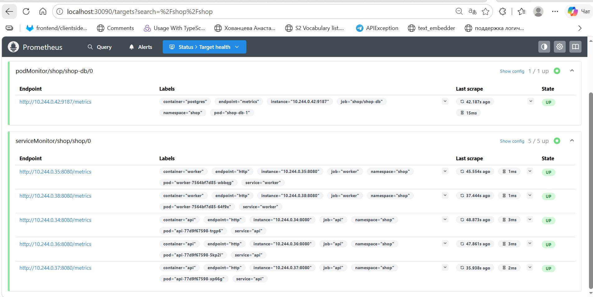

| Алерт | Зачем |
|---|---|
| ShopApiHighErrorRate | пользователи получают ошибки при оформлении заказа |
| ShopApiReplicasUnavailable | часть реплик не готова, так выглядит застрявшее обновление, пока сервис ещё работает |
| ShopOrdersBacklog | заказы копятся необработанными, worker не работает или Postgres недоступен |

Остановил `worker` (`--replicas=0`) и создал заказы. Первая версия `ShopOrdersBacklog` смотрела только на метрику `shop_orders_pending`. Но эту метрику отдаёт сам worker, и без worker её просто нет, поэтому алерт молчал. Я добавил в правило `absent(up{job="worker"} == 1)`, и после этого `ShopOrdersBacklog` сработал.

Вывод: если алерт смотрит на метрику, которую отдаёт сам наблюдаемый сервис, он не заметит, что сервис умер. Нужна отдельная проверка, что метрика вообще есть.

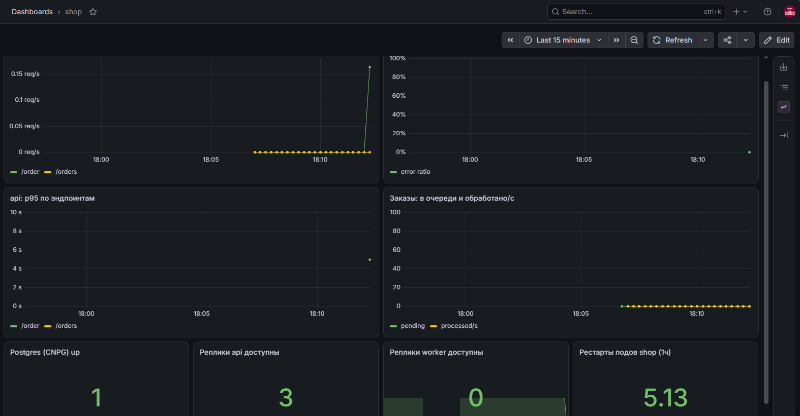

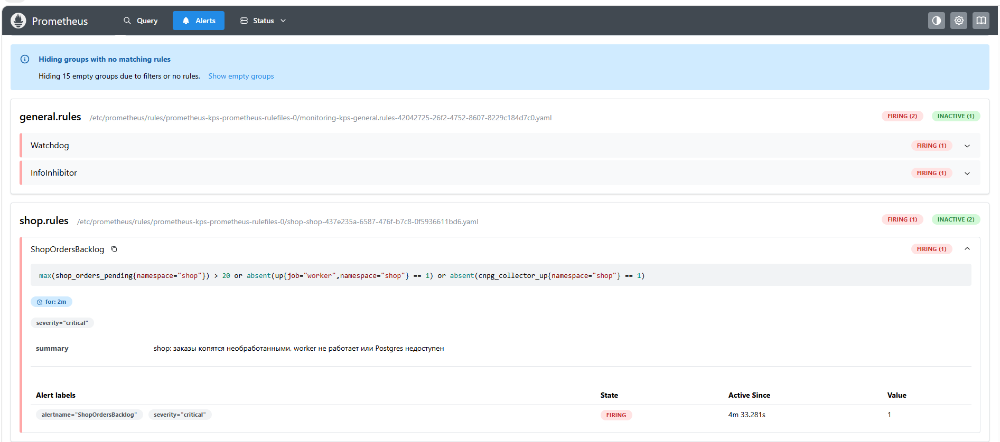

Потом вернул worker через `helm upgrade --reset-values`. Обычный `helm upgrade` без параметров снова взял `worker.replicas=0` из прошлого `--set`, поэтому понадобился явный сброс. Worker поднялся до 2 реплик и разобрал очередь.

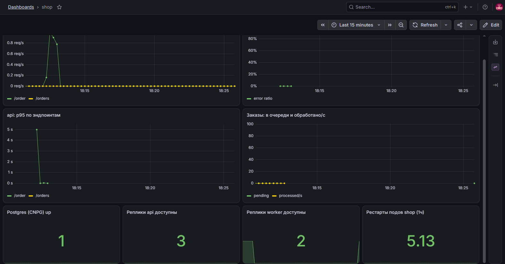
