# Лаба 4. SLA для оформления заказа при перегрузке

Кластер minikube из двух нод (`minikube` и `minikube-m02`), сеть на Cilium. Всё меняется через общий чарт `shop`. Изменения этой лабы лежат в `values-lab4.yaml`, применяю их командой `~/containers/shop/scripts/deploy.sh 4`: она ставит чарт лабы 3 и сверху `values-lab4.yaml`. Временные эксперименты вынес в отдельные файлы `part6-fill.yaml` и `part7-memory.yaml`, они передаются через `-f` и основной файл не трогают.

## Часть 0. Сервис batch

Сделал `batch`. Это контейнер, который просто грузит процессор и держит память. Сколько процессов грузить CPU (`CPU_WORKERS`) и сколько памяти держать (`MEM_MB`), задаётся через переменные окружения. Образ `shop.local/batch:1.0` собрал и загрузил на обе ноды.

## Часть 1. Как разносить реплики

Добавил в values параметр `api.spread.mode`. В базе он `none`, как было в лабе 3, а в `values-lab4.yaml` стоит `topologySpread`. Шаблон `api.yaml` по этому параметру добавляет либо `topologySpreadConstraints`, либо `podAntiAffinity`.

Выбрал `topologySpreadConstraints`. Почему:
- `podAntiAffinity` говорит «не ставь рядом с таким же подом». Если сделать его обязательным, то при 3 репликах и 2 нодах третьей реплике некуда встать, и она навсегда зависнет в Pending. Если сделать его желательным, планировщик под нагрузкой может его нарушить и сложить всё на одну ноду;
- `topologySpreadConstraints` следит за перекосом. С `maxSkew: 1` на двух нодах получается 2+1, и ни одна реплика не зависает. При росте числа реплик или нод правило продолжает работать;
- `matchLabelKeys: [pod-template-hash]` считает поды старой и новой версии отдельно, чтобы при обновлении старые поды не мешали считать.

## Часть 2. Тесная площадка

Кластер из двух нод. Каждая нода показывает планировщику 4 CPU и около 7.75 ГиБ памяти (`Allocatable`): с драйвером docker kubelet видит ресурсы всей VM. Уже занято по requests: на `minikube` 980m CPU и 814Mi, на `minikube-m02` 660m и 1304Mi.

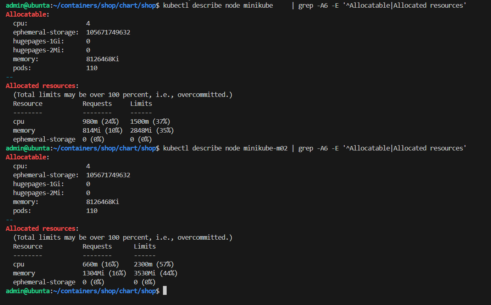

Добавил `batch` в чарт отдельным шаблоном с requests и limits. Requests заметно меньше limits (100m/64Mi против 500m/768Mi), то есть QoS у него Burstable. Развернул через `deploy.sh 4`: batch запустился, реплики api разошлись по двум нодам.

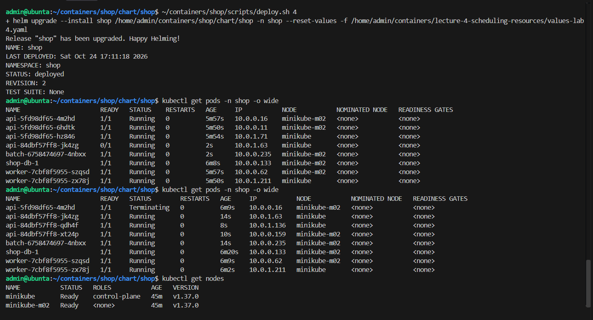

Правила Kyverno из лабы 3 действуют и на batch. Без limits Kyverno не пустил Deployment, сработало правило `autogen-containers-have-requests-and-limits`.

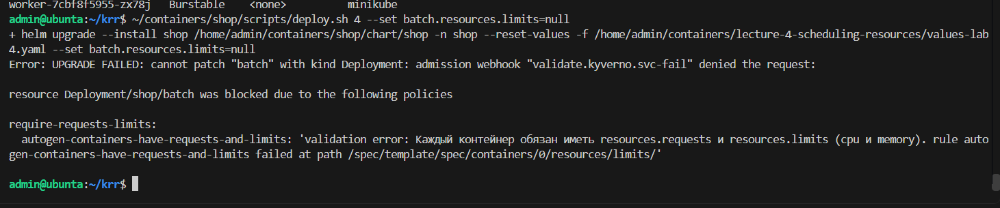

## Часть 3. Числа от krr

Запустил k6 на `POST /order`: 20 запросов в секунду, 15 минут. Метрики клиента k6 пишет в Prometheus.

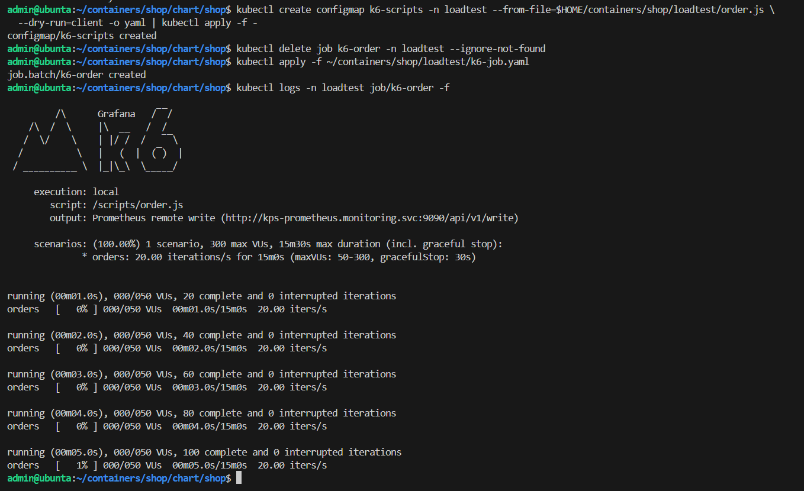

Потом запустил `krr simple` по namespace `shop`. Стратегия simple считает так: CPU request это 95-й перцентиль потребления, CPU limit не ставит, память это максимум плюс 15%.

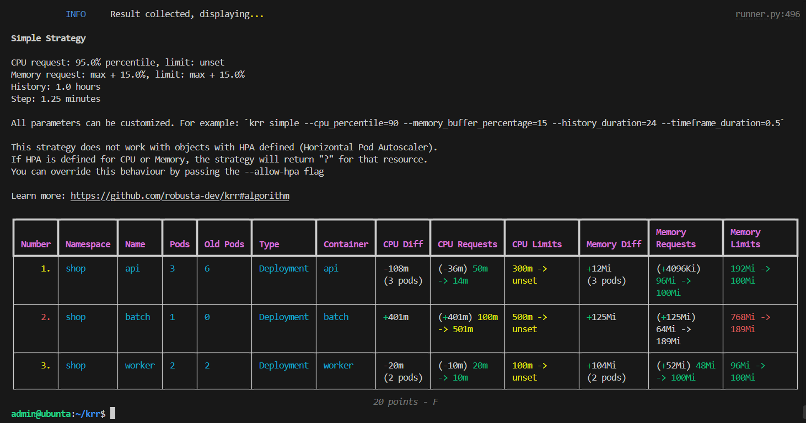

Сначала krr на все контейнеры отвечал `No data`. Оказалось, что при Docker 29 kubelet отдаёт метрики только по подам, без метки `container`, а krr ищет именно по контейнерам. Я включил в стеке мониторинга сбор `/metrics/resource`, там метки правильные, повторил нагрузку, и krr выдал рекомендации. Postgres krr не видит, потому что его поды создаёт оператор напрямую, без Deployment. Для него я посчитал то же самое запросами в Prometheus.

| Контейнер | Моя догадка в лабе 3 (request / limit) | Что сказал krr | Что поставил |
|---|---|---|---|
| api | CPU 50m / 300m, память 96Mi / 192Mi | CPU 14m, память 100Mi | 50m / 50m, 100Mi / 100Mi (Guaranteed) |
| worker | CPU 20m / 100m, память 48Mi / 96Mi | CPU 10m, память 100Mi | 10m / 100m, 100Mi / 100Mi |
| postgres | CPU 100m / 500m, память 256Mi / 384Mi | CPU 27m, память 209Mi, с запасом 241Mi | 100m / 100m, 256Mi / 256Mi (Guaranteed) |
| batch | CPU 100m / 500m, память 64Mi / 768Mi | CPU 501m, память 189Mi | не менял |

Почему цифры разошлись:
- в лабе 3 я ставил с запасом «на всякий случай». При 20 запросах в секунду лимиты api и postgres оказались больше нужного в 2–6 раз;
- у api и worker krr упёрся в свои минимумы (10m CPU и 100Mi памяти), реально они потребляют ещё меньше;
- krr не советует CPU limit, а для QoS Guaranteed нужно, чтобы request и limit были равны. Если поставить limit 14m, как у p95, api будет тормозить на любом всплеске. Поэтому CPU я взял с запасом (api 50m, postgres 100m), а память поставил по krr;
- для batch krr предлагает 501m, но batch специально сделан Burstable с низким приоритетом, его не трогал.

## Часть 4. Разносим api

Реплики api стоят 2+1: две на `minikube`, одна на `minikube-m02`.

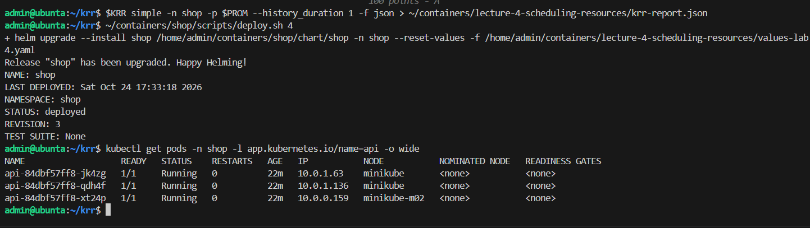

Если одна нода упадёт или её выведут на обслуживание, потеряется не больше двух реплик из трёх. Оставшаяся продолжит отвечать, пока Kubernetes поднимает замену на живой ноде.

## Часть 5. Приоритеты, QoS, PDB

Добавил в чарт:
- PriorityClass `shop-critical` (100000, может вытеснять других) и `shop-batch` (100, `preemptionPolicy: Never`, сам никого не вытесняет);
- PodDisruptionBudget для api (`minAvailable: 2`) и Postgres (`minAvailable: 1`). Встроенный PDB оператора CNPG при этом выключается, чтобы не было двух одинаковых.

Что получилось:
- api и `shop-db-1`: Guaranteed и `shop-critical`;
- batch: Burstable и `shop-batch`;
- worker: Burstable без приоритета.

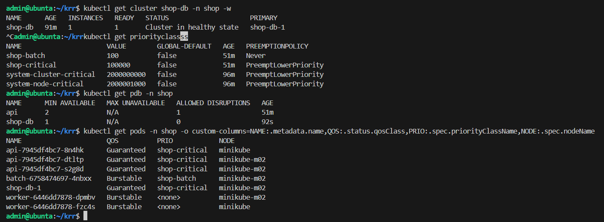

Что это даёт, когда ресурсов не хватает:
- **приоритет**: если новому важному поду не хватает места, планировщик выгонит поды с меньшим приоритетом. Ещё приоритет учитывается, когда kubelet выбирает, кого выселить при нехватке памяти;
- **QoS**: при нехватке памяти kubelet сначала выселяет поды, которые используют больше своего request, а из них первыми те, у кого ниже приоритет. Guaranteed не может использовать больше request, потому что request равен limit, поэтому его выселяют последним. OOM killer ядра тоже трогает его последним;
- **Burstable и Guaranteed**: Burstable может брать память сверх request, и при нехватке именно это у него и забирают первым;
- **PDB** защищает только от плановых операций: drain ноды, обновление нод. Когда kubelet выселяет поды из-за нехватки памяти, PDB не учитывается. У Postgres одна реплика, поэтому `minAvailable: 1` фактически не даст сделать drain его ноды.

## Часть 6. Pending и вытеснение

Занял CPU нод через requests: 7 реплик batch по 1 CPU, при этом сами они процессор не грузят (`CPU_WORKERS: 0`). Пять реплик встали, две ушли в Pending.

У Pending-подов написано `0/2 nodes are available: 2 Insufficient cpu`. Планировщик складывает requests, а не смотрит, сколько CPU реально используется. Вытеснить кого-то batch тоже не может: `not eligible due to preemptionPolicy=Never`, у него низкий приоритет и запрет вытеснять.

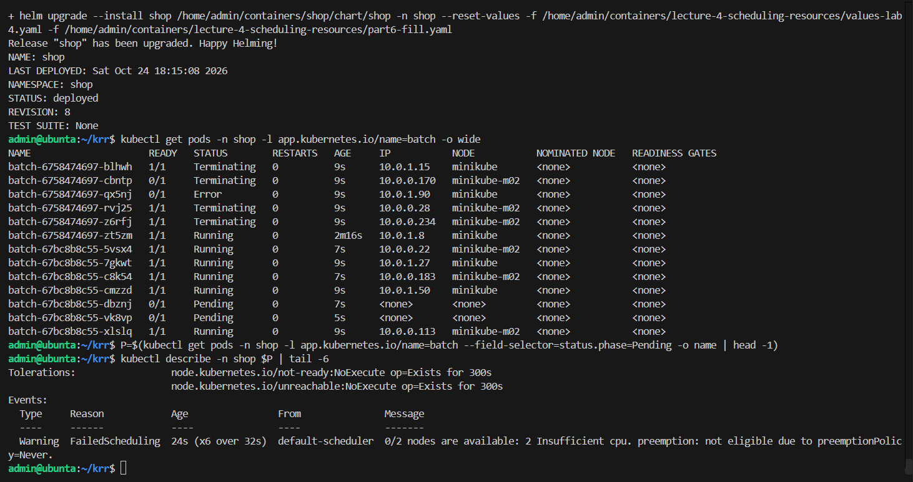

Обычный под api просит всего 50m CPU и поместился бы в остаток на нодах, вытеснять никого бы не понадобилось. Поэтому для проверки я на время дал api request 1 CPU. Новому поду api с приоритетом `shop-critical` места не хватило, и планировщик решил вытеснить batch: `preemption: found a potential placement for pod on node minikube, preempting 1 victims`. Batch удалили, и новый под api запустился на его месте.

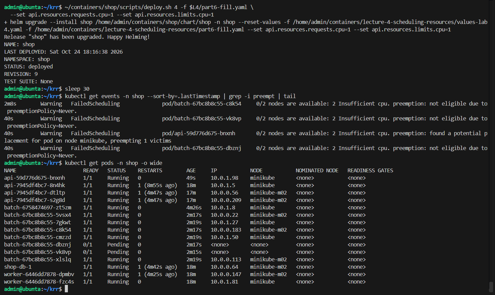

## Часть 7. Нехватка памяти: кого выселяют первым

Чтобы нода почувствовала нехватку памяти и при этом не зависла вся VM, я поднял порог `evictionHard: memory.available` в kubelet ноды `minikube-m02`. Порог посчитал так: сколько памяти свободно сейчас минус примерно 600Mi, получилось 6000Mi. Свободная память на ноде перед опытом:

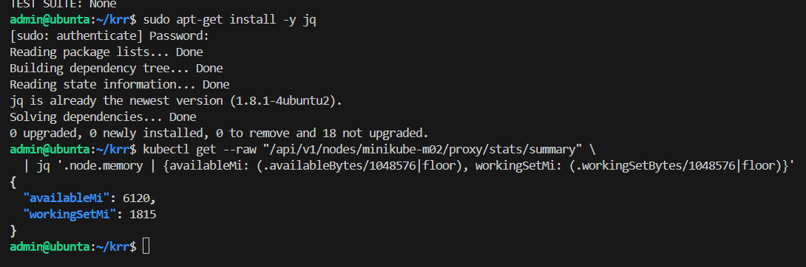

Потом посадил на m02 две реплики batch, каждая держит около 400 МБ (`part7-memory.yaml`). Нода перешла в `MemoryPressure: True` и получила taint `memory-pressure:NoSchedule`. Kubelet выселил batch, а api и `shop-db-1` на той же ноде продолжили работать.

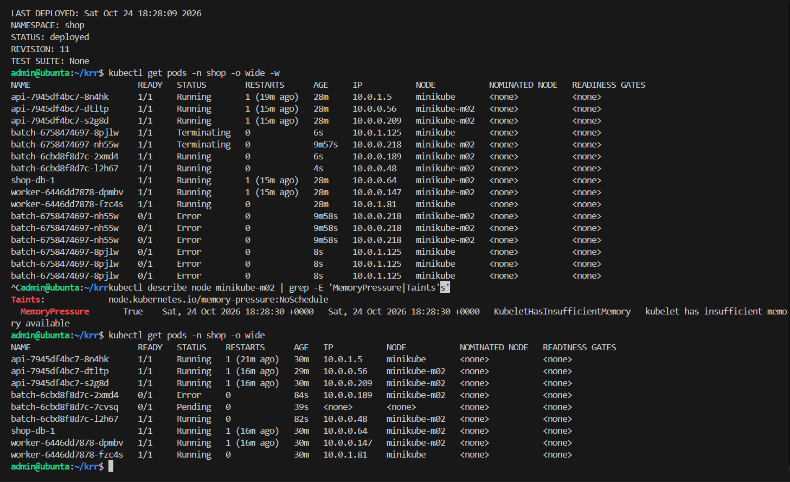

В сообщении kubelet написано, почему выбрал batch: `Threshold quantity: 6000Mi, available: 6136784Ki. Container batch was using 420528Ki, request is 64Mi, has larger consumption of memory`. Batch занимал около 410 МБ при request 64Mi, то есть превышал request больше всех, и приоритет у него самый низкий. Api и Postgres имеют QoS Guaranteed и свой request не превышают.

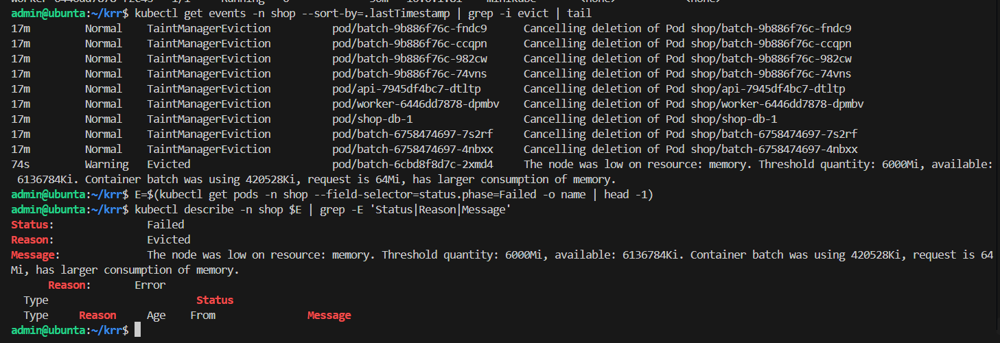

Для сравнения вернул порог как был и дал batch 900 МБ при его собственном лимите 768Mi. Контейнер получил OOMKilled с кодом выхода 137.

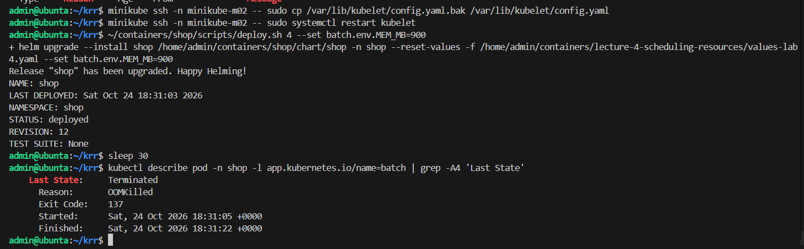

В обоих случаях под умирает, но причины разные:
- **Evicted**: решение kubelet, потому что не хватает памяти на всей ноде. Под удаляется целиком, и вместо него создаётся новый, может быть на другой ноде. Помогает добавить памяти на ноду или правильно выставить requests и QoS;
- **OOMKilled**: процесс убило ядро, потому что контейнер превысил свой собственный limit. Контейнер перезапускается в том же поде, растёт `RESTARTS`. Помогает поднять limit или найти утечку памяти.

## Часть 8. SLA под нагрузкой

Мой SLA: 95% запросов `POST /order` быстрее 300 мс и ошибок меньше 1%, даже когда batch вытесняют и выселяют.

Пока 15 минут работал k6 (20 запросов в секунду), я повторил обе перегрузки: по CPU из части 6 (Pending и вытеснение) и по памяти из части 7 (выселение).

Результат k6:
- 18 000 запросов, p95 57 мс, медиана 3.2 мс;
- ошибок 0.04%, это 8 из 18 000;
- обе проверки пройдены: `http_req_duration p(95)<300` и `http_req_failed rate<0.01`.

Эти 8 ошибок пришлись на момент, когда api перезапускался с увеличенным request во время опыта с вытеснением.

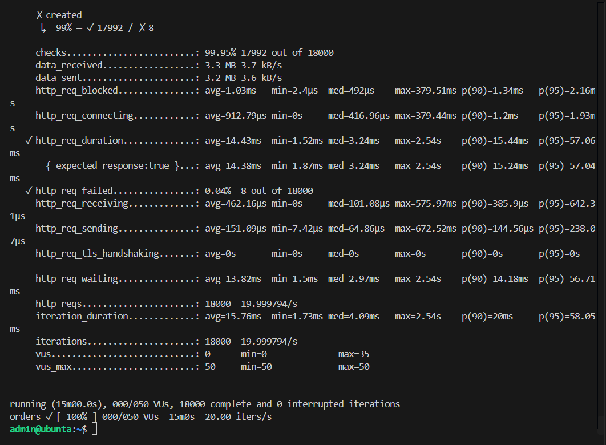

Дашборд `Lab4` (выгружен в `dashboard.json`):
- p95 заказа на сервере держится около 50 мс, далеко ниже линии 300 мс;
- p95 у клиента k6 около 57 мс. Скачок в самом начале из-за того, что k6 считает перцентиль с начала прогона, и первые медленные запросы на разгоне его поднимают;
- доля ошибок у клиента почти ноль;
- на панели batch видно, что страдает именно он: 4 пода в Pending и меньше доступных реплик в опыте с CPU, потом выселение в опыте с памятью.

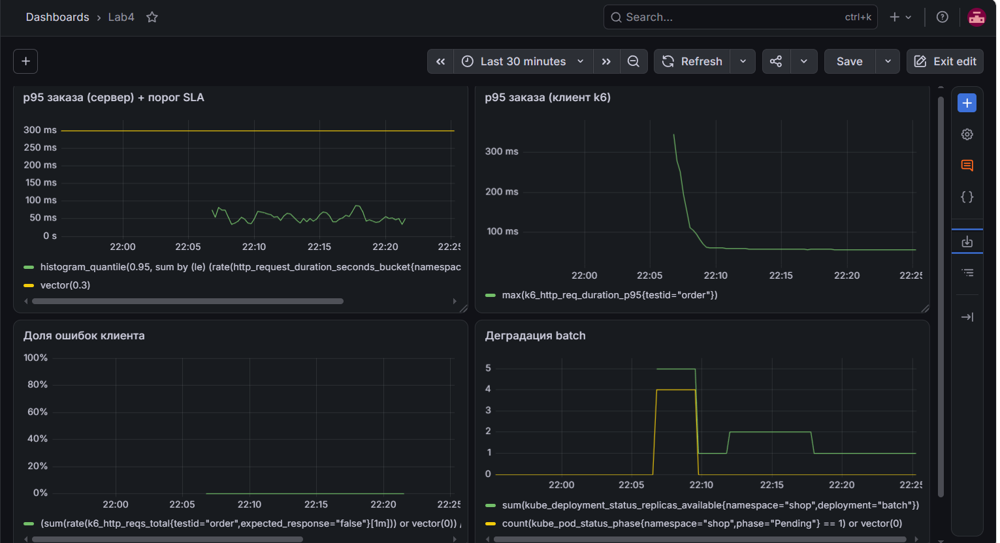

## Часть 9. Мониторинг

Добавил в чарт группу алертов `shop.capacity` (включается флагом `monitoring.rules.capacity`):

| Алерт | Зачем |
|---|---|
| ShopOrderLatencySLOBreach | p95 заказа больше 300 мс уже 5 минут, SLA нарушен |
| ShopCriticalPodPending | под api или Postgres не может встать на ноду 2 минуты и больше, места не осталось даже после вытеснения |
| NodeMemoryPressure | на ноде не хватает памяти, kubelet уже выселяет поды. Пока страдает batch, но запас кончается |

Во время опыта с памятью сработал `NodeMemoryPressure` для `minikube-m02`:

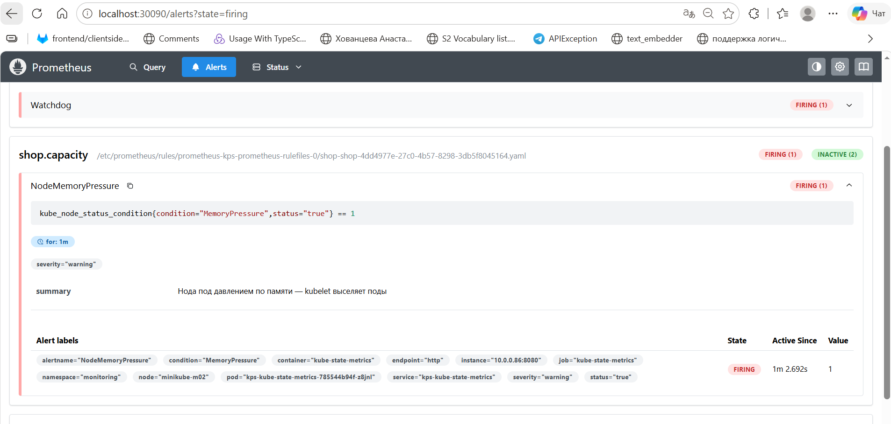

Алерт дошёл до Alertmanager и получателя `webhook`. Там же горит `ShopOrdersBacklog` из лабы 3: пока batch и worker на m02 выселялись и пересоздавались, заказы какое-то время не обрабатывались.

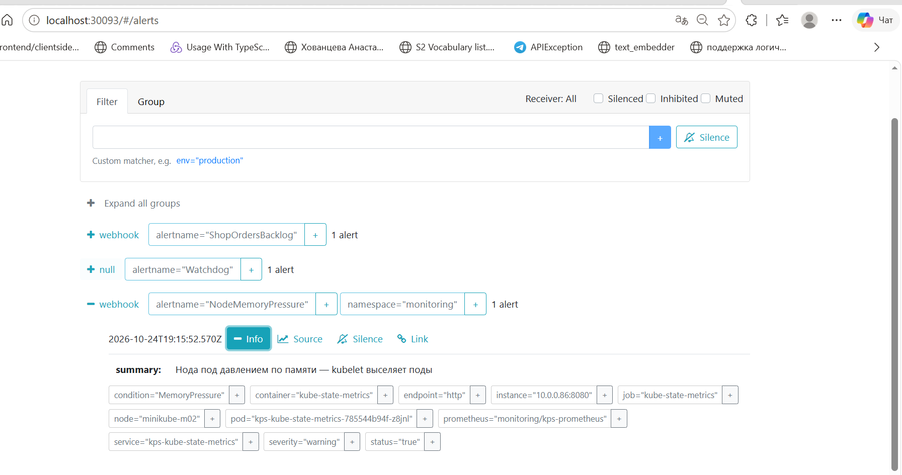

## С чем пришлось повозиться

- Kyverno не пускал служебный под, который создаёт тома (образ busybox в namespace `local-path-storage`), и том для Postgres не создавался. Добавил `local-path-storage` в исключения правил.
- Ноде с control plane не хватало 3 ГиБ памяти. Она начинала постоянно читать с диска, API-сервер отвечал с таймаутами, а контроллеры падали. Перераспределил память между нодами через `docker update`.
- krr отвечал `No data` из-за того, как kubelet отдаёт метрики при Docker 29. Помог сбор `/metrics/resource`.
- Когда я забивал CPU множеством маленьких подов batch, кончалась память на ноде и падал etcd. Переделал опыт на несколько больших подов по 1 CPU.
