# Лаба 5. Zero-trust сеть для shop

Кластер тот же, что в лабе 4: minikube из двух нод (`minikube` и `minikube-m02`), сеть на Cilium с Hubble. Всё меняется через общий чарт `shop`. Изменения этой лабы лежат в `values-lab5.yaml`, применяю их командой `~/containers/shop/scripts/deploy.sh 5`. Она ставит чарт с values лаб 3 и 4, а сверху кладёт `values-lab5.yaml`. Batch из лабы 4 выключил, чтобы он не мешал опытам.

## Часть 0. Выбор CNI

Выбрал Cilium. Почему:
- политики применяет eBPF-программа на интерфейсе каждого пода;
- правила привязаны к identity пода, а она считается по его меткам. Под пересоздаётся с новым IP, а правила продолжают работать;
- Hubble показывает каждый поток с вердиктом и причиной. Это нужно в части 6, чтобы искать поломку по фактам, а не наугад.

Стандартный kindnet политики не выполняет. API-сервер примет объект NetworkPolicy, но в сети его никто не применит.

В кластере Cilium работает в режиме туннеля (VXLAN). Сервисы обслуживает обычный kube-proxy (`KubeProxyReplacement: False`), режим у него `iptables`.

## Часть 1. Сеть пода

Зашёл в под api на ноде `minikube` через debug-контейнер с netshoot. Что увидел:
- у пода свой интерфейс `eth0@if9` с адресом `10.0.1.95/32`. Адрес взят из подсети ноды `10.0.1.0/24`;
- маршрут по умолчанию идёт через `10.0.1.182`, это адрес `cilium_host` на ноде;
- `iflink` равен 9, это номер парного интерфейса на ноде;
- worker на другой ноде (`10.0.0.148`) отвечает напрямую по IP пода.

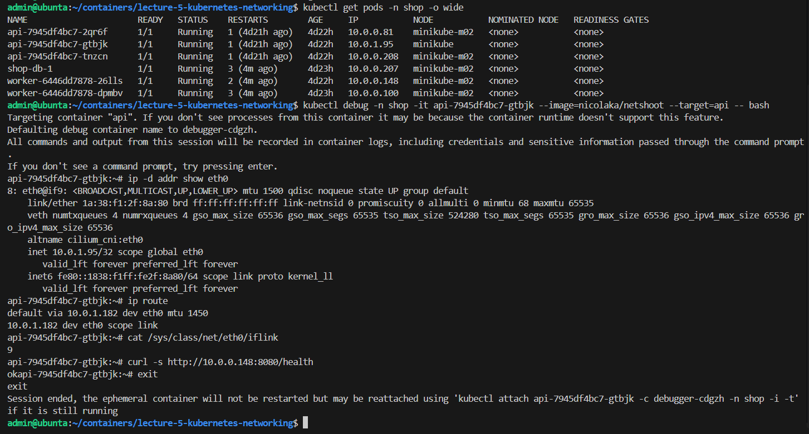

На ноде нашёл интерфейс с номером 9: `lxcc38ca6f4b768@if8`. Это второй конец той же veth-пары. Подсети обеих нод маршрутизируются через `cilium_host`. Трафик к другой ноде уходит в туннель `cilium_vxlan` (порт 8472).

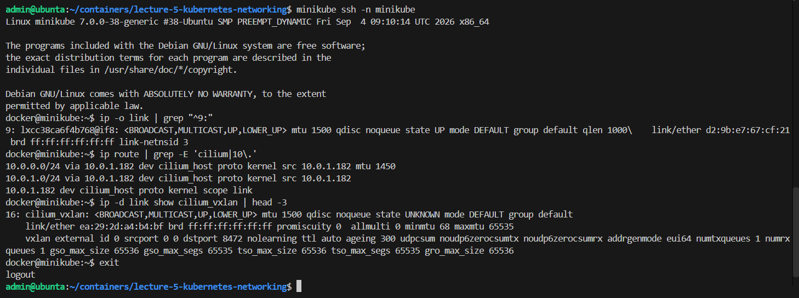

Как под получает сеть. Kubelet при создании пода вызывает CNI-плагин. Плагин создаёт veth-пару, один конец переносит внутрь пода как `eth0`, выдаёт IP из подсети ноды и прописывает маршрут. Отдельных маршрутов на каждый `lxc` нет, пакет до нужного пода доставляет eBPF. Между нодами пакеты идут с IP пода на IP пода внутри VXLAN, без NAT.

## Часть 2. Непрерывность под хаосом

Api доступен снаружи через NodePort 30080. Написал два скрипта:
- `chaos.sh` раз в 6 секунд удаляет случайный под api или worker;
- `chaos.js` для k6 10 минут шлёт 20 запросов в секунду на `api.shop.svc.cluster.local`. Каждый запрос идёт через новое TCP-соединение, поэтому каждый раз заново выбирается под.

За 9 минут хаоса скрипт удалил 88 подов. Ни один запрос не упал.

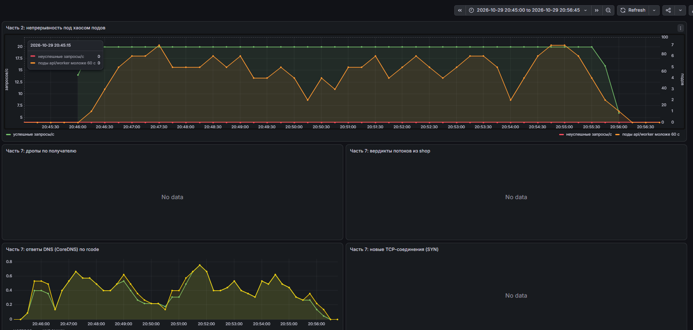

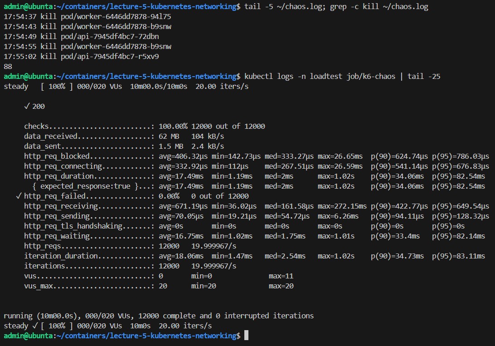

Почему ошибок нет:
- **DNS** отдаёт ClusterIP сервиса. Этот адрес не меняется, клиент IP подов вообще не видит;
- **EndpointSlice** содержит только Ready-поды. Удаляемый под сразу оттуда пропадает, а новый попадает туда только после readiness-пробы;
- **kube-proxy** следит за EndpointSlice и переписывает правила iptables. Новое соединение идёт только на живой под;
- **preStop** (`sleep 5`) даёт время убрать под из правил на всех нодах. После этого gunicorn дорабатывает начатые запросы.

Типы Service:
- **NodePort**: открывает порт на каждой ноде, внешний клиент сам выбирает, на какую ноду идти;
- **LoadBalancer**: то же самое плюс внешний балансировщик с одним адресом;
- **headless**: виртуального IP нет, DNS отдаёт адреса всех подов, балансирует сам клиент. Так делают для баз данных, где нужно обращаться к конкретной реплике.

kube-proxy у меня в режиме `iptables`. Он проходит правила по очереди и при каждом изменении переписывает их целиком. IPVS использует хеш-таблицы и работает быстрее. Разница заметна только на тысячах сервисов, у меня их десяток.

## Часть 3. Целевая матрица

| Откуда \ Куда | api | worker | postgres | DNS | интернет |
|---|---|---|---|---|---|
| клиент (NodePort, loadtest) | ✅ | ❌ | ❌ | - | - |
| api | - | ❌ | ✅ | ✅ | ❌ |
| worker | ❌ | - | ✅ | ✅ | ❌ |
| postgres | ❌ | ❌ | ✅ реплики | ✅ | только kube-apiserver |
| посторонний под | ❌ | ❌ | ❌ | ✅ | ❌ |
| Prometheus | ✅ | ✅ | ✅ метрики | - | - |
| оператор CNPG | - | - | ✅ порт 8000 | - | - |

Что легко забыть:
- без доступа к DNS ни один сервис не найдёт другой по имени;
- без доступа Prometheus мониторинг перестанет видеть поды;
- Postgres из CNPG ходит в API-сервер Kubernetes, а оператор ходит в под Postgres на порт 8000. Без этого кластер БД сломается.

## Часть 4. Zero-trust через чарт

Добавил в чарт шаблон `networkpolicy.yaml`. Порты и метки берутся из values, а в `values-lab5.yaml` политики только включаются (`networkPolicy.enabled: true`). Что в шаблоне:
1. `default-deny-all` запрещает весь входящий и исходящий трафик подов в namespace;
2. `allow-dns-egress` разрешает всем подам ходить в CoreDNS;
3. разрешения по меткам и портам: любой клиент к api на 8080, Prometheus к worker, api и worker к Postgres, Postgres к своим репликам, оператор и Prometheus к Postgres;
4. CiliumNetworkPolicy разрешает Postgres ходить в kube-apiserver. Обычный `ipBlock` тут не подходит, потому что в Cilium у API-сервера своя identity.

Политики складываются. Если под попал хотя бы под одну политику, разрешено только то, что перечислено в их правилах. Соединение должно быть разрешено с двух сторон: egress у источника и ingress у получателя.

## Часть 5. Проверка матрицы

Для проверки создал под `intruder` в namespace `shop`. Он проходит правила Kyverno, но ни в одно разрешение не входит. Ещё создал под `client` в namespace `loadtest`. Скрипт `matrix.sh` пробует TCP-подключение из каждого источника к каждому адресату и сравнивает результат с матрицей.

До включения политик сеть плоская. Открыто всё: посторонний под подключается к Postgres, все поды ходят в интернет. Из 14 строк не совпадают 11.

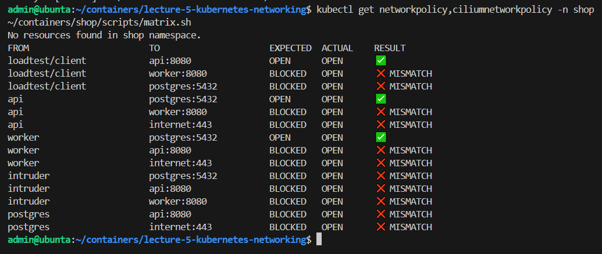

Включил политики. Postgres остался в состоянии `Cluster in healthy state`, `POST /order` отвечает 201, матрица совпала полностью: 14 из 14.

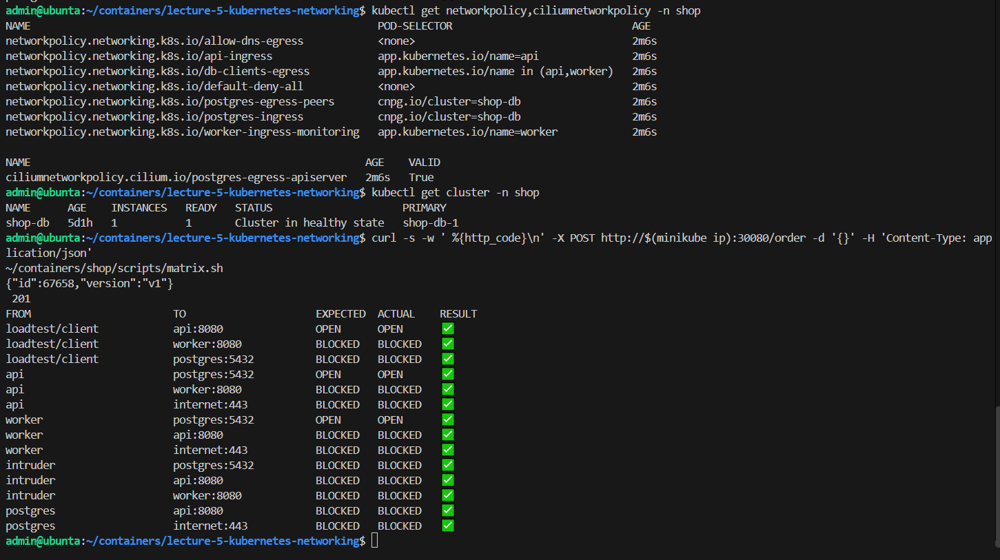

Строку про Prometheus проверил в Targets. Все цели `shop` в состоянии UP: api, worker и shop-db. Значит, скрейп метрик не сломался.

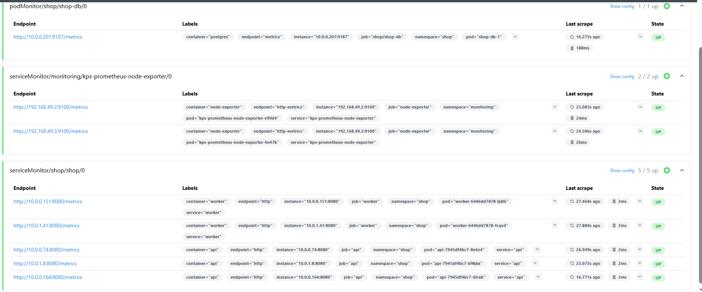

## Часть 6. Скрытая поломка

Написал `break.sh`. Он выбирает одну из четырёх поломок, применяет её через `--set` поверх обычного деплоя и перезапускает api и worker. Какую выбрал, не пишет, а записывает в файл `~/.shop-breakage` в base64. Варианты:
- нет разрешения DNS;
- неверная метка в разрешении для Postgres (`api-svc` вместо `api`);
- неверный порт в разрешении для Postgres (5433 вместо 5432);
- слишком широкое deny-правило.

Перед слепым запуском проверил все четыре варианта по отдельности. У каждого в Hubble свой след:

| Поломка | Что видно в Hubble |
|---|---|
| нет DNS | `shop/… → kube-system/coredns:53 UDP`, EGRESS DENIED |
| неверная метка | только `api → shop-db-1:5432`, INGRESS DENIED, worker проходит |
| неверный порт | и api, и worker → `shop-db-1:5432`, INGRESS DENIED |
| широкое deny | `api → shop-db-1:5432`, `Policy denied by denylist` |

Потом запустил `break.sh` вслепую и искал причину.

**Симптом.** `POST /order` висит минуту и отвечает 503 `db unavailable`. При этом все поды Running, а `/health` отвечает 200. Значит, процессы живы, сломана связь с базой. В логе api только `couldn't get a connection after 30.00 sec`. Пакеты отбрасываются молча, и пул соединений просто ждёт свои 30 секунд. По такому логу нельзя понять, что именно сломано.

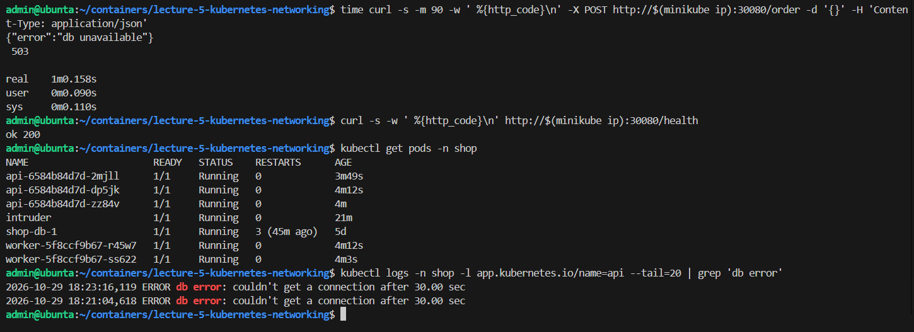

**Что режется.** `hubble observe -n shop --verdict DROPPED` показал потоки `worker → shop-db-1:5432` и `api → shop-db-1:5432` с `INGRESS DENIED`. Режет входящее правило Postgres, и сразу для обоих клиентов. Значит, дело не в метке одного клиента, а в самом правиле. Дропов на CoreDNS нет, DNS работает.

**Причина.** В политике `postgres-ingress` метки правильные (`api`, `worker`), но разрешён порт 5433. Service `shop-db-rw` и Postgres работают на 5432.

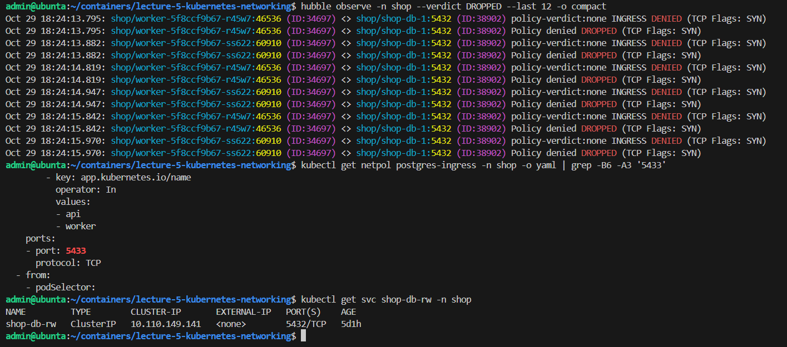

То же видно в Hubble UI: красная пунктирная линия к `postgres:5432` и вердикт `dropped`.

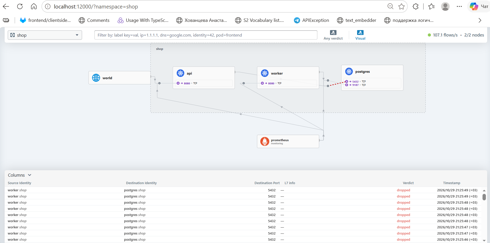

**Починка.** Запустил `deploy.sh 5` без поломки и перезапустил api и worker. Заказ снова проходит, матрица снова 14 из 14. Файл `~/.shop-breakage` подтвердил диагноз: `2 --set networkPolicy.postgres.port=5433`.

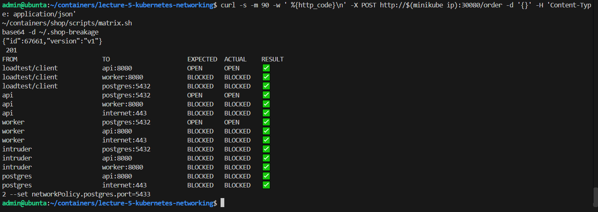

## Часть 7. Мониторинг

Добавил в чарт ServiceMonitor для метрик Hubble (сервис `hubble-metrics` в `kube-system`) и группу алертов `shop.network`. Включается флагами `monitoring.hubble` и `monitoring.rules.network`.

| Алерт | Зачем |
|---|---|
| ShopPolicyDrops | политики режут трафик к подам shop. Значит, сломано правило или кто-то лезет туда, куда нельзя |
| ShopDNSBlocked | поды не могут резолвить имена. Это самая частая поломка egress-политик, и снаружи её не видно: поды живы, а ничего не работает |
| ShopWorkerDbUnreachable | worker больше минуты не может сходить в Postgres, заказы не обрабатываются. Этот алерт не зависит от CNI |

Сделал дашборд `Lab5` (выгружен в `dashboard.json`). На нём дропы политик по парам «источник → получатель», вердикты потоков из `shop`, ответы DNS и новые TCP-соединения.

Для проверки снова запустил `break.sh`. В этот раз выпала неверная метка: дропы идут только от трёх подов api к `shop-db-1`, worker проходит. Через 2 минуты `ShopPolicyDrops` перешёл в firing.

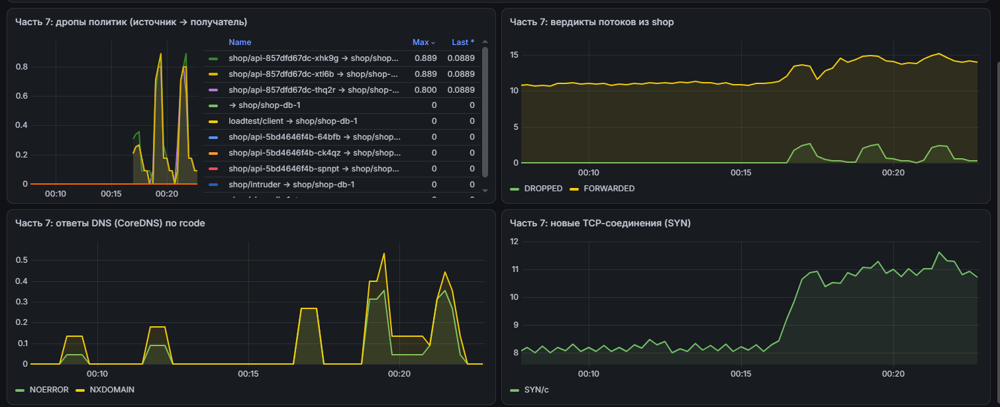

`ShopDNSBlocked` и `ShopWorkerDbUnreachable` остались неактивными: DNS работает, worker до базы достаёт. Из прошлых лаб сработал `ShopApiHighErrorRate`, потому что api отвечал 503.

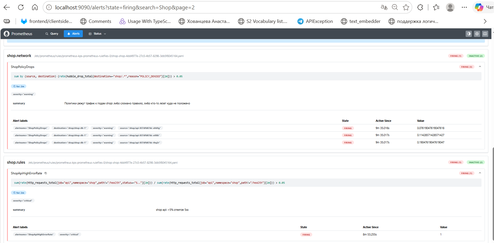

После скринов починил, файл подтвердил: `1 --set networkPolicy.postgres.allowFrom={api-svc,worker}`.

## С чем пришлось повозиться

- Запрос `POST /order` при поломке отвечает 503 не сразу, а через 30–60 секунд. Это таймаут пула соединений psycopg. Сначала curl отваливался раньше с кодом `000`, пришлось поставить ему таймаут 90 секунд.
- `ShopPolicyDrops` в первый раз погас, хотя поломка осталась. Пул соединений после серии неудач делает паузы между попытками, дропов становится мало, и порог алерта не достигается. Для скрина пустил постоянную нагрузку на `/order`. Вывод: алерту на дропы нужен парный алерт на симптом, у меня это `ShopApiHighErrorRate`.
- На панели дропов сначала было много шума с причинами `UNSUPPORTED_L3_PROTOCOL` и `STALE_OR_UNROUTABLE_IP`, к политикам они не относятся. Оставил на панели только `POLICY_DENIED`.
- После перезапуска кластера под Grafana завис в `ContainerStatusUnknown`. Удалил его, Deployment создал новый.
