# Лаба 6. Автопилот релиза на service mesh

Кластер тот же, что в лабах 4-5: minikube из двух нод, Cilium. Все изменения применяю через общий чарт `shop` и файл `values-lab6.yaml` командой `~/containers/shop/scripts/deploy.sh 6`.

## Часть 0. Сервисы

Использую `api` из лабы 3. В нём есть `/version`, переключатели `FAIL` и `FLAKY`. Версии v1 и v2 - один образ с разной переменной `VERSION`.

Скрипт-гейт - это Deployment с ServiceAccount и RBAC, который раз в 15 секунд читает метрики из Prometheus и меняет веса в `HTTPRoute`.

## Часть 1. Выбор mesh

Выбрал Linkerd. Прокси на Rust, mTLS по умолчанию, traffic split настраивается стандартным `HTTPRoute`. Istio ambient для L7 (split, retries) требует waypoint-прокси на Envoy, это больше компонентов и памяти. Для одного сервиса Linkerd проще.

## Часть 2. Baseline без mesh

Развернул `api` v1 (2 реплики) и `postgres` без mesh. Прогнал k6 на 20 RPS в течение 5 минут по `POST /order`. Снял метрики через Prometheus.

Результаты baseline:

- p50 / p95 / p99: 3.74 / 75.68 / 174.52 мс.
- CPU api: 43.2 mC.
- RAM api: 140.1 MiB.
- Control plane Linkerd (уже стоял в кластере, но не использовался): 3.9 mC / 154.5 MiB.

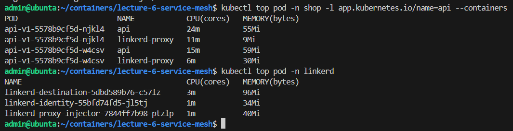

## Часть 3. Mesh и mTLS

Включил mesh аннотациями в чарте (`linkerd.io/inject: enabled`). Клиент (`curl` в неймспейсе `loadtest`) тоже в mesh. Сетевые политики из лабы 5 дополнил: разрешил прокси ходить в control plane Linkerd и открыл порты прокси (4143, 4190, 4191).

`linkerd viz edges` показывает соединение клиент -> api как SECURED, с identity `default.loadtest` и `default.shop`. Identity выдаётся на основе ServiceAccount, а не IP.

В `tcpdump` на ноде видно TLS-рукопожатие и зашифрованные данные. Без mesh тот же запрос читается открытым текстом (`GET /orders HTTP/1.1`).

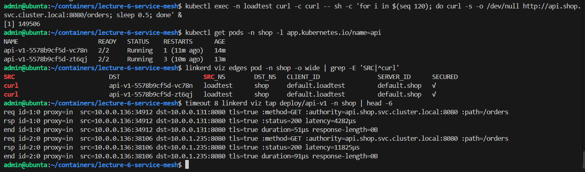

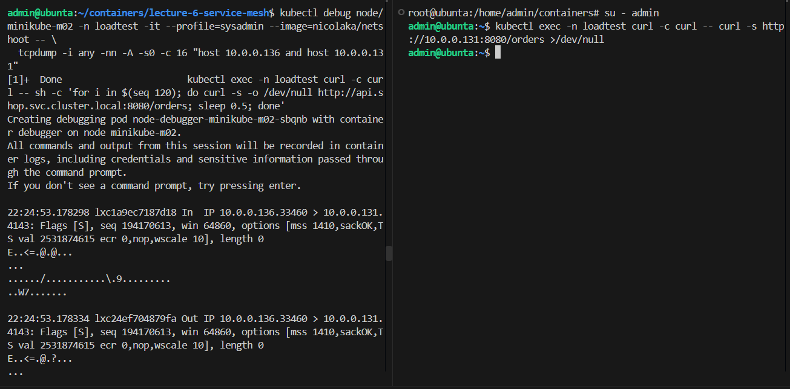

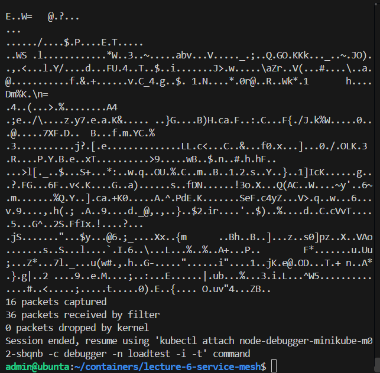

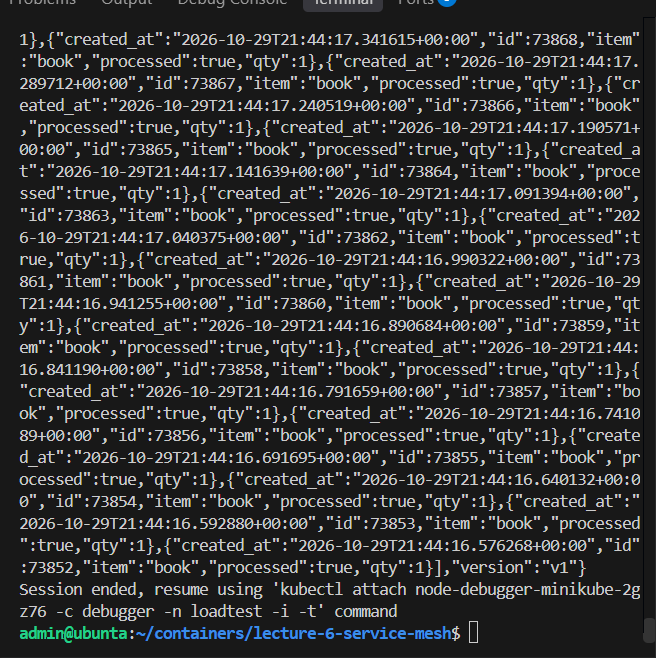

## Часть 4. Надёжность бесплатно

Включил `FLAKY=true` (30% запросов падают в коде) и retries в mesh. Backend реально отдаёт ~30% ошибок. Клиент видит меньше 1%.

Сработали retries. В метриках прокси клиента растут счётчики повторов (`outbound_http_route_retry_requests_total`), а балансировщик endpoint-ы не исключает. Клиент увидит ошибку, только если упадут все 4 попытки: 0.3^4 = 0.8%.

Circuit breaking (failure accrual) не сработал. Он исключает endpoint после 7 ошибок подряд, а при случайных 30% это почти невероятно (0.3^7). Проверка: с выключенными retries клиент сразу видит ~29% ошибок.

Цена - усиление нагрузки на backend (~1.4 запроса на каждый клиентский) и маскировка деградации.

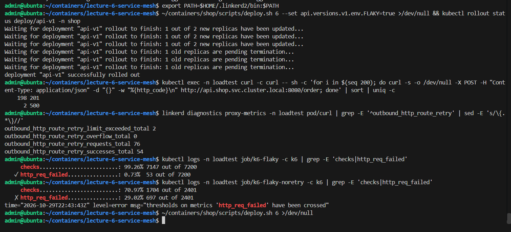

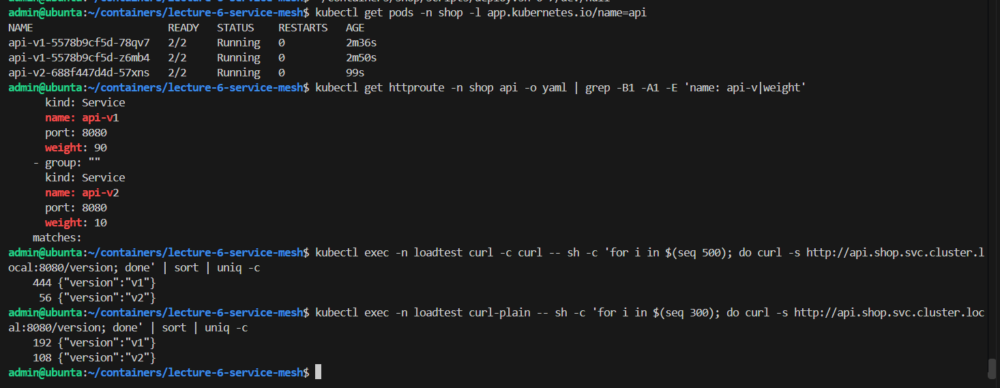

## Часть 5. Traffic split

Развернул v1 и v2 одновременно и настроил `HTTPRoute` с весами 90/10. Из 500 запросов к `/version` около 450 вернули v1 и около 50 - v2.

Делит трафик прокси клиента по маршруту, полученному от control plane Linkerd. Клиент вне mesh этот split не видит: у него kube-proxy раскидывает запросы по числу подов (300 запросов дали 192 v1 и 108 v2, то есть 2:1).

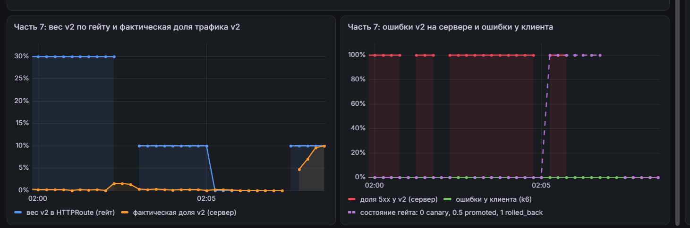

## Часть 6. Автопилот

Логика гейта:

- Сигналы: доля 5xx и p95 у v2 на `POST /order` за последнюю минуту. Метрики серверные, retries могут скрыть ошибки от клиента.
- Мало трафика: если у v2 меньше минимального RPS, гейт ждёт.
- Откат: ошибки > 5% или p95 > 500 мс - вес v2 сразу становится 0.
- Продвижение: после двух здоровых проверок подряд вес v2 растёт на 20%, до 100%.
- Асимметрия: откат быстрый, продвижение медленное.

## Часть 7. Два сценария

### Плохой релиз

Выкатил v2 с `FAIL=true`. Гейт увидел 100% ошибок, переждал warmup и откатил релиз по голоданию (потому что failure accrual выбил v2 из балансировки). Вес v2 упал до 0.

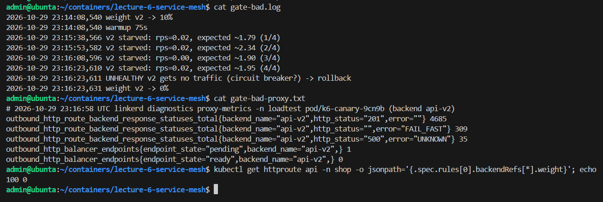

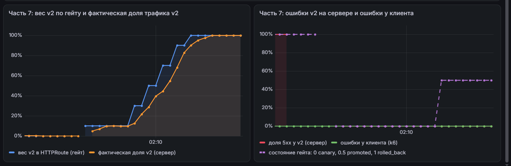

### Хороший релиз

Выкатил здоровую v2. Гейт довёл её долю с 10% до 100%. Ошибок нет.

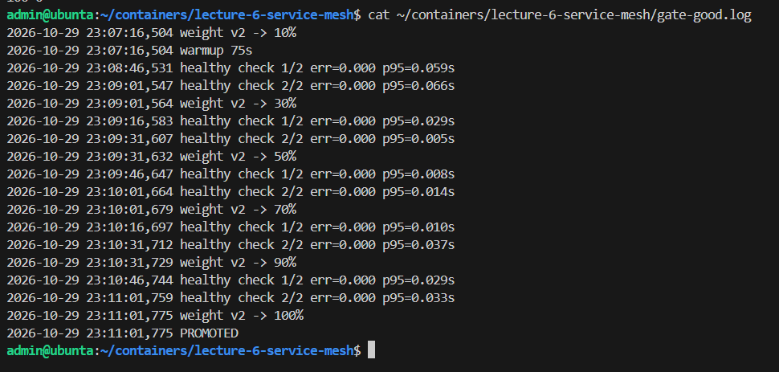

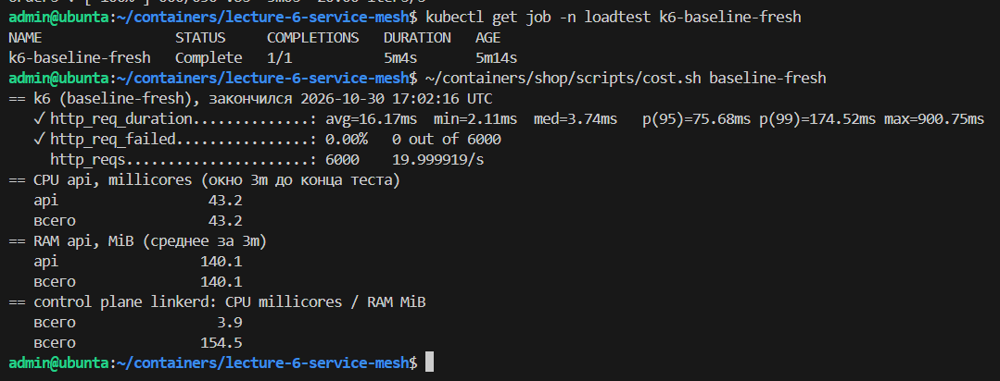

## Часть 8. Цена mesh

Повторил замер baseline с mesh. Клиент в mesh, retries/FLAKY выключены, canary выключен.

| **Метрика** | **Baseline** | **С mesh** | **Разница** |
| :--- | :--- | :--- | :--- |
| p50 / p95 / p99, мс | 3.74 / 75.68 / 174.52 | 4.25 / 95.67 / 149.37 | +0.51 / +19.99 / -25.15 |
| CPU api (приложение + прокси), mC | 43.2 | 56.0 | +12.8 |
| RAM api (приложение + прокси), MiB | 140.1 | 153.0 | +12.9 |
| Control plane Linkerd (CPU / RAM) | 3.9 mC / 154.5 MiB | 4.0 mC / 172.5 MiB | +0.1 / +18.0 |

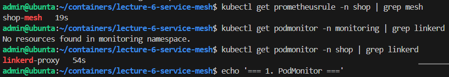

Вердикт. Для одного сервиса с парой реплик постоянная цена mesh (control plane ~170 MiB и прокси ~15 mC / ~13 MiB на под) сопоставима с самим приложением. p95 вырос на 20 мс из-за двух дополнительных хопов и TLS. p99 уменьшился из-за шума. mTLS и retries здесь можно получить дешевле. Mesh окупается при большом числе сервисов, когда нужны единый mTLS с авторизацией по identity, одинаковые L7-метрики без правок кода и прогрессивные релизы.

## Часть 9. Мониторинг

Добавил в чарт PodMonitor для прокси Linkerd и группу правил `shop.mesh`.

| **Алерт** | **Обоснование** |
| :--- | :--- |
| ShopCanaryV2Failing | v2 отдаёт >5% ошибок по данным mesh - страховка на случай, если гейт не сработал |
| ShopCanaryRolledBack | гейт откатил релиз: автоматика отработала, но релиз не доставлен, нужен разбор |
| ShopBackendErrorsMaskedByRetries | backend падает, а клиенты этого не видят из-за retries - скрытая деградация |

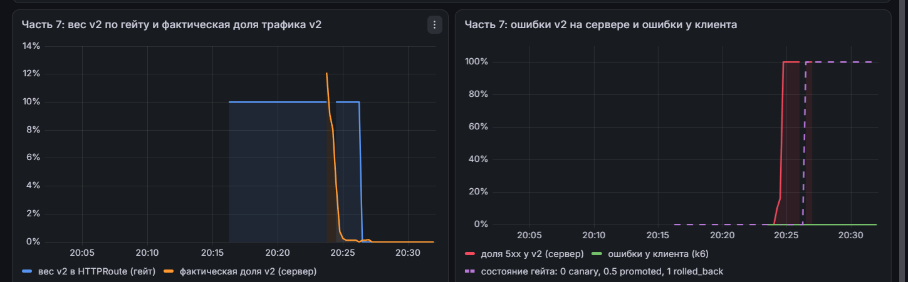

После сценария с плохим релизом алерты `ShopCanaryRolledBack` и `ShopOrdersBacklog` перешли в firing.

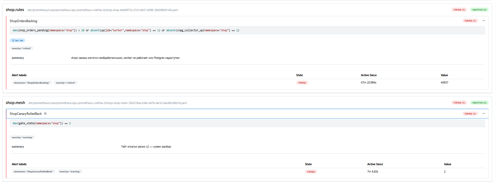

## С чем пришлось повозиться

- `cost.sh` падал, если вызывать его до того, как Job с k6 перейдёт в статус `Complete`. Native sidecar Linkerd завершается с задержкой, поэтому скрипт видел пустой `completionTime` и делал запросы с `@ 0`.

- PodMonitor для Linkerd прокси сначала не скрейпился, потому что лежал в неймспейсе `shop`, а не `monitoring`. Prometheus Operator по умолчанию собирает их из всех неймспейсов, поэтому пришлось просто поправить команду проверки (`kubectl get podmonitor -n shop`).

- Гейт при плохом релизе откатывал не по `err=1.000`, а по голоданию. Failure accrual выбивал единственный под v2 из балансировщика после 7 ошибок, и до сервера доходило ~0.02 RPS. Пришлось добавить в гейт проверку `STARVE_CHECKS`, чтобы он понимал, что нет трафика при наличии общего - это тоже сломанный релиз.